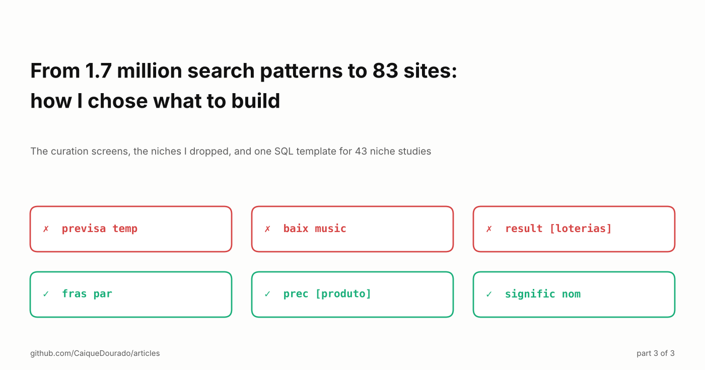
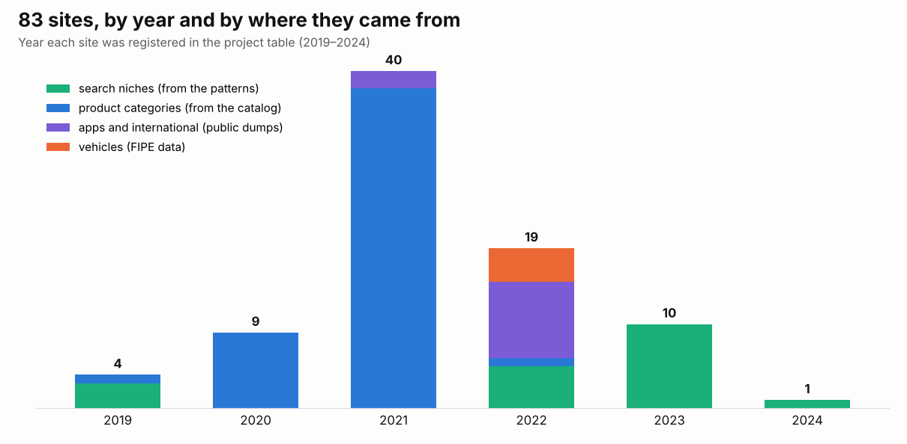
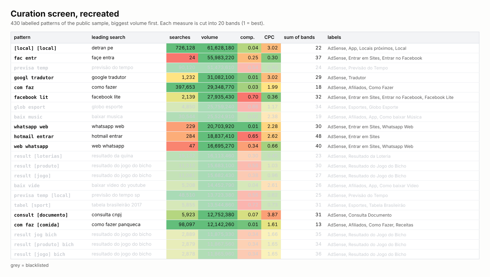

# From 1.7 million search patterns to 83 sites: how I chose what to build

*The curation screens, the niches I dropped, and one SQL template for 43 niche studies. Part 3 of 3.*

[Leia em português](README.pt-BR.md) · [On Medium](https://medium.com/@caiquedourado/from-1-7-million-search-patterns-to-83-sites-how-i-chose-what-to-build-f764687dfe12) · Part 1: [Seven ways to turn millions of Google searches into page templates](https://medium.com/@caiquedourado/seven-ways-to-turn-millions-of-google-searches-into-page-templates-3671235eac0f) · Part 2: [Almost 400 million search patterns, five databases, and what actually worked](https://medium.com/@caiquedourado/almost-400-million-search-patterns-five-databases-and-what-actually-worked-139cb4a28c4e)

[Part 1](https://medium.com/@caiquedourado/seven-ways-to-turn-millions-of-google-searches-into-page-templates-3671235eac0f)
turned Google searches into page templates. [Part 2](https://medium.com/@caiquedourado/almost-400-million-search-patterns-five-databases-and-what-actually-worked-139cb4a28c4e)
was about running that over tens of millions of searches. This last part is the reason for all of it: deciding what to
build. Between 2019 and 2024 my project table registered **83 sites**. This article is about how they were chosen, not
about how they performed.

## Two factories, not one

The first thing the project table shows is that the sites came from two different places:

- **Search niches**, chosen from the patterns: prices, sizes, customer service phone numbers, questions and answers,
  quotes, Bible verses, names, words, dreams, Excel tips, teas, store reviews. 19 sites, from 2019 to 2024.
- **Product categories**, generated from the product catalog I was crawling: *Tudo sobre Fogão*, *Tudo sobre Panelas*,
  *Tudo para o PET*… 49 sites, 38 of them in October 2021 alone. Here the decision was not "which niche" but "which
  categories have enough products", and the catalog answered it.

Two smaller groups sit in between: apps sites in several countries built from a public dump of the App Store (11), and
vehicle sites built from the FIPE price table (4). Both had a large label in the patterns (*App*: 41,188 patterns;
*Veículos*: 14,786), but the site was only possible because a data source existed.

## The curation screens

The patterns went into a few internal screens, and I read them row by row. The recreation below uses the public
sample of the [google-keywords-dataset](https://github.com/CaiqueDourado/google-keywords-dataset), with the same rules
the screens had.

- **One row per pattern**, biggest volume first, with the number of searches, total monthly volume, average competition
  and CPC, and the leading search, so I never had to read `previsa temp`.
- **Every measure cut into 20 bands** (`NTILE(20)`), painted with Excel's green-to-red scale: green is the top 5%.
  The sum of the bands sorts the rows by "good on everything at once".
- **Two marks per row**: *seen*, so I could stop and resume on the exact row the next day, and *labels*, free text
  separated by commas: how the pattern makes money (AdSense, affiliates) and what site it asks for (prices, phrases,
  sizes, recipes…).
- **One screen per label** then added up every pattern with that label: how many searches, how much volume, which
  examples. That screen was the shortlist.

154,654 patterns got labels. The labels are, almost one to one, the names of the niche sites:

| Pattern in the public sample | Leading search | Label | Site |
|---|---|---|---|
| `prec [produto]` | preço de celular | Preço de Produtos | Preço Atualizado (2019) |
| `fras par` | frases para status | Frases | Frases para Redes Sociais (2022) |
| `signific nom` | significado de nomes | Significado dos Nomes | Significado dos Nomes e Sobrenomes (2023) |
| `telefon [company]` | telefone net | Telefone | Whatsapp e Telefones de Empresas (2022) |

Two sites even keep in the project table the label they came from (*Preço de Produtos*, *Tamanho de Produtos*).

## The top of the table was a list of what not to build

Sort the labelled patterns by volume and the first rows are `fac entr` (*facebook entrar*), `previsa temp` (*previsão
do tempo*), `googl tradutor`, `glob esport`, `baix music` (*baixar música*), `whatsapp web`, `result [loterias]`,
`result [jogo]` (*resultado do jogo do bicho*). Tens of millions of searches a month each. None became a site.

The screens had a blacklist that greyed out whole themes: weather, music and video downloads, dubbed films, lotteries
and the animal game, football clubs. The reason was always the same: **competition**. These searches have huge volume
because a few giants already own them: the weather services, the sports portals, the platforms people are trying to
open. Behind them, page two.

The trap is in the numbers. The "competition" column of keyword tools measures **advertisers**, not the sites that rank:
*previsão do tempo* has enormous volume and a cheap click, so on the screen it looks green. What I needed, and did not
have in the table, was who sits on the first page. The navigational searches (*facebook entrar*, *whatsapp web*) are
the same trap in a purer form: nobody searching them wants a third site.

What survived the blacklist were templates with **many small searches**, each with its own entity: thousands of
products with a price, thousands of names with a meaning, thousands of companies with a phone number. Large in total,
small one by one, and no giant had a page for each.

## The second method: one SQL template, 43 niches

Later, with a second batch of keywords (from DataForSEO), I stopped scrolling screens and wrote **one SQL template for a niche
study**, then ran it 43 times: drinks, gelatin, sauces, soups, juices, fillings, home remedies, "pet pode comer",
prayers, legends, jokes, "o que é o que é", "qual a diferença", "para que serve", "você sabia", step by step, top 10,
tutorials, generators, browser extensions, guides, "em inglês" and eight other languages, square metres, sunscreen,
vitamins, store tracking…

Each study answered the same five questions:

1. **The searches**, biggest first.
2. **The total**: volume, average competition and CPC, count.
3. **The words** inside them, by frequency.
4. **The two- and three-word prefixes**, the poor man's prefix algorithm in pure SQL.
5. **The residual entity**: remove the niche words and group by what is left. `REPLACE(keyword, 'molho', '')` turns
   *molho de tomate*, *molho branco*, *molho madeira* into the list of sauces, which is the list of pages.

The residual entity is the most useful trick in this whole series: it finds the slot of a template without a dictionary.

The traps were in the filters, and they are worth knowing if you do SEO with SQL or a spreadsheet: `LIKE '%oração%'`
also matches *coração* (heart); `%ios%` matches *correios*; `%pet%` matches *competir*; `%amostra%` matches *amostragem*;
replacing `pra` cuts *prata* in half. Separating *gerador de nomes* (name generator) from *gerador elétrico* took three
exclusions; separating *rastreio de pedido* (order tracking) from *rastreador veicular* (vehicle tracker) took nineteen.

There was also a table of 501 raw ideas, one line each, that I read in random order with `ORDER BY NEWID()`. Only four ever got scores for difficulty, gain and time. One of them reads *Criar mais sites
Categorizados*: build more category sites.

## What I would do differently

- **Measure organic competition, not ad competition.** Pull the first page of results for the leading search of each
  pattern and score who is there. That one column would have saved a lot of reading at the top of the table.
- **Start from the residual entity.** It finds the slots of a template and the list of pages in one query.
- **Write the decision down.** Two sites kept the label they came from; for the rest I had to rebuild the link from the
  names. A one-line reason per site would have turned 83 sites into 83 experiments.

## The end of the series

Three parts: how searches become templates, what it took to run that at scale, and how the templates became sites.
The code, the data and the dictionary are all open:

- The algorithms: [search-pattern-miner](https://github.com/CaiqueDourado/search-pattern-miner) (Python and .NET)
- Searches, patterns and labels: [google-keywords-dataset](https://github.com/CaiqueDourado/google-keywords-dataset) ([Kaggle](https://www.kaggle.com/datasets/caiquedourado/google-keywords-dataset))
- The entity dictionary: [portuguese-entity-gazetteer](https://github.com/CaiqueDourado/portuguese-entity-gazetteer)
- The articles: [github.com/CaiqueDourado/articles](https://github.com/CaiqueDourado/articles)

*Caique Dourado has spent 20 years building crawlers, data pipelines and programmatic SEO in .NET and SQL Server.*
