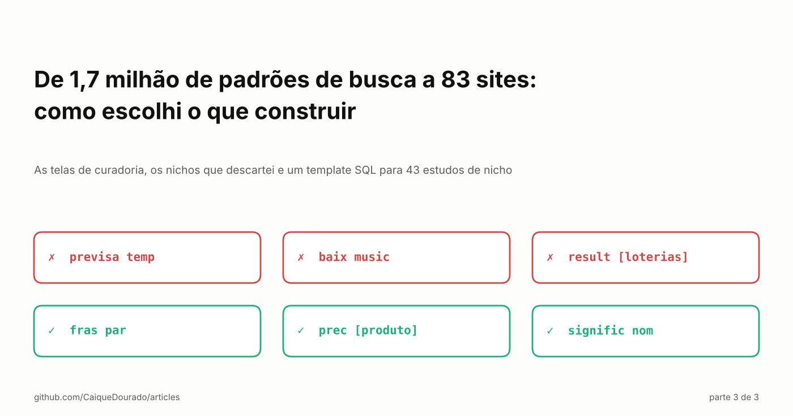
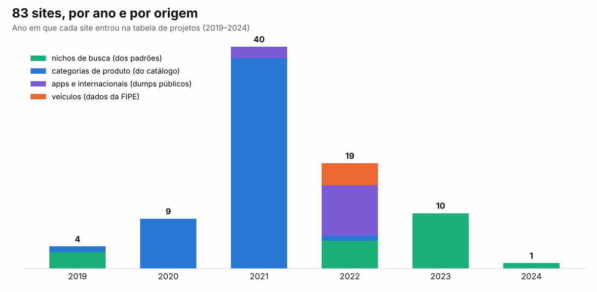
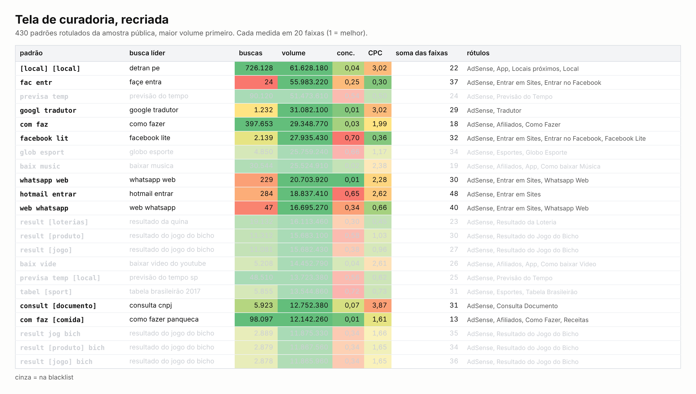

# De 1,7 milhão de padrões de busca a 83 sites: como escolhi o que construir

*As telas de curadoria, os nichos que descartei e um template SQL para 43 estudos de nicho. Parte 3 de 3.*

[Read in English](README.md) · Parte 1: [Sete jeitos de transformar milhões de buscas do Google em modelos de página](../seven-ways-search-patterns/README.pt-BR.md) · Parte 2: [Quase 400 milhões de padrões de busca, cinco bancos de dados e o que de fato funcionou](../scale-search-patterns/README.pt-BR.md)

A [parte 1](../seven-ways-search-patterns/README.pt-BR.md) transformou buscas do Google em modelos de página. A
[parte 2](../scale-search-patterns/README.pt-BR.md) foi sobre rodar isso em dezenas de milhões de buscas. Esta última
parte é o motivo de tudo: decidir o que construir. Entre 2019 e 2024 a minha tabela de projetos registrou **83 sites**.
Este artigo é sobre como eles foram escolhidos, não sobre como se saíram.

## Duas fábricas, não uma

A primeira coisa que a tabela de projetos mostra é que os sites vieram de dois lugares diferentes:

- **Nichos de busca**, escolhidos pelos padrões: preços, tamanhos, telefones de atendimento, dúvidas e respostas,
  frases, versículos, nomes, palavras, sonhos, dicas de Excel, chás, avaliação de lojas. 19 sites, de 2019 a 2024.
- **Categorias de produto**, geradas a partir do catálogo de produtos que eu coletava: *Tudo sobre Fogão*, *Tudo sobre
  Panelas*, *Tudo para o PET*… 49 sites, 38 deles só em outubro de 2021. Aqui a decisão não era "qual nicho", e sim
  "quais categorias têm produtos suficientes", e o catálogo respondia.

Dois grupos menores ficam no meio: sites de aplicativos em vários países, feitos a partir de um dump público da App
Store (11), e sites de veículos feitos a partir da tabela FIPE (4). Os dois tinham um rótulo grande nos padrões (*App*:
41.188 padrões; *Veículos*: 14.786), mas o site só foi possível porque existia uma fonte de dados.

## As telas de curadoria

Os padrões iam para algumas telas internas, e eu lia linha por linha. A recriação abaixo usa a amostra pública do
[google-keywords-dataset](https://github.com/CaiqueDourado/google-keywords-dataset), com as mesmas regras das telas.

- **Uma linha por padrão**, maior volume primeiro, com o número de buscas, o volume mensal total, a concorrência e o
  CPC médios, e a busca líder, para eu nunca precisar ler `previsa temp`.
- **Cada medida cortada em 20 faixas** (`NTILE(20)`), pintadas com a escala verde-vermelho do Excel: verde são os 5%
  melhores. A soma das faixas ordena as linhas por "bom em tudo ao mesmo tempo".
- **Duas marcas por linha**: *visto*, para eu parar e retomar na linha exata no dia seguinte, e *rótulos*, texto livre
  separado por vírgulas: como o padrão ganha dinheiro (AdSense, afiliados) e que site ele pede (preços, frases,
  tamanhos, receitas…).
- **Uma tela por rótulo** somava todos os padrões com aquele rótulo: quantas buscas, quanto volume, quais exemplos. Essa
  tela era a lista curta.

154.654 padrões ganharam rótulos. Os rótulos são, quase um a um, os nomes dos sites de nicho:

| Padrão na amostra pública | Busca líder | Rótulo | Site |
|---|---|---|---|
| `prec [produto]` | preço de celular | Preço de Produtos | Preço Atualizado (2019) |
| `fras par` | frases para status | Frases | Frases para Redes Sociais (2022) |
| `signific nom` | significado de nomes | Significado dos Nomes | Significado dos Nomes e Sobrenomes (2023) |
| `telefon [company]` | telefone net | Telefone | Whatsapp e Telefones de Empresas (2022) |

Dois sites guardam até hoje, na tabela de projetos, o rótulo de onde vieram (*Preço de Produtos*, *Tamanho de
Produtos*).

## O topo da tabela era uma lista do que não construir

Ordene os padrões rotulados por volume e as primeiras linhas são `fac entr` (*facebook entrar*), `previsa temp`
(*previsão do tempo*), `googl tradutor`, `glob esport`, `baix music` (*baixar música*), `whatsapp web`,
`result [loterias]`, `result [jogo]` (*resultado do jogo do bicho*). Dezenas de milhões de buscas por mês cada um.
Nenhum virou site.

As telas tinham uma blacklist que acinzentava temas inteiros: previsão do tempo, download de música e vídeo, filmes
dublados, loterias e jogo do bicho, clubes de futebol. O motivo era sempre o mesmo: **concorrência**. Essas buscas têm
volume enorme porque poucos gigantes já são donos delas: os serviços de previsão do tempo, os portais de esporte, as
plataformas que as pessoas tentam abrir. Atrás deles, a página dois.

A armadilha está nos números. A coluna de "concorrência" das ferramentas de palavras-chave mede **anunciantes**, não os
sites que ranqueiam: *previsão do tempo* tem volume enorme e clique barato, então na tela parece verde. O que eu
precisava, e não tinha na tabela, era quem está na primeira página. As buscas de navegação (*facebook entrar*,
*whatsapp web*) são a mesma armadilha em estado puro: quem busca isso não quer um terceiro site.

O que sobrevivia à blacklist eram modelos com **muitas buscas pequenas**, cada uma com a sua entidade: milhares de
produtos com preço, milhares de nomes com significado, milhares de empresas com telefone. Grandes no total, pequenas uma
a uma, e nenhum gigante tinha uma página para cada.

## O segundo método: um template SQL, 43 nichos

Mais tarde, com um segundo lote de palavras-chave (da DataForSEO), parei de rolar telas e escrevi **um template SQL de
estudo de nicho**, e rodei 43 vezes: drinks, gelatina, molhos, sopas, sucos, recheios, remédios caseiros, "pet pode
comer", orações, lendas, piadas, "o que é o que é", "qual a diferença", "para que serve", "você sabia", passo a passo,
top 10, tutoriais, geradores, extensões de navegador, guias, "em inglês" e mais oito idiomas, metro quadrado, protetor
solar, vitaminas, rastreamento de lojas…

Cada estudo respondia às mesmas cinco perguntas:

1. **As buscas**, maiores primeiro.
2. **O total**: volume, concorrência e CPC médios, contagem.
3. **As palavras** dentro delas, por frequência.
4. **Os prefixos de duas e três palavras**, o algoritmo de prefixo dos pobres, em SQL puro.
5. **A entidade residual**: tire as palavras do nicho e agrupe pelo que sobra. `REPLACE(keyword, 'molho', '')`
   transforma *molho de tomate*, *molho branco*, *molho madeira* na lista de molhos, que é a lista de páginas.

A entidade residual é o truque mais útil desta série inteira: ela acha a vaga de um modelo sem dicionário nenhum.

As armadilhas estavam nos filtros, e vale conhecer se você faz SEO com SQL ou planilha: `LIKE '%oração%'` também pega
*coração*; `%ios%` pega *correios*; `%pet%` pega *competir*; `%amostra%` pega *amostragem*; trocar `pra` corta *prata* ao
meio. Separar *gerador de nomes* de *gerador elétrico* levou três exclusões; separar *rastreio de pedido* de
*rastreador veicular* levou dezenove.

Havia também uma tabela de 501 ideias cruas, uma por linha, que eu lia em ordem aleatória com `ORDER BY NEWID()`. Só
quatro chegaram a ganhar nota de dificuldade, ganho e tempo. Uma delas diz *Criar mais sites Categorizados*.

## O que eu faria diferente

- **Medir a concorrência orgânica, não a de anúncios.** Buscar a primeira página de resultados da busca líder de cada
  padrão e pontuar quem está lá. Essa única coluna teria poupado muita leitura no topo da tabela.
- **Começar pela entidade residual.** Ela acha as vagas de um modelo e a lista de páginas numa consulta só.
- **Anotar a decisão.** Dois sites guardaram o rótulo de onde vieram; para o resto tive de reconstruir a ligação pelos
  nomes. Uma linha de motivo por site teria transformado 83 sites em 83 experimentos.

## O fim da série

Três partes: como buscas viram modelos, o que foi preciso para rodar isso em escala, e como os modelos viraram sites.
O código, os dados e o dicionário estão todos abertos:

- Os algoritmos: [search-pattern-miner](https://github.com/CaiqueDourado/search-pattern-miner) (Python e .NET)
- Buscas, padrões e rótulos: [google-keywords-dataset](https://github.com/CaiqueDourado/google-keywords-dataset) ([Kaggle](https://www.kaggle.com/datasets/caiquedourado/google-keywords-dataset))
- O dicionário de entidades: [portuguese-entity-gazetteer](https://github.com/CaiqueDourado/portuguese-entity-gazetteer)
- Os artigos: [github.com/CaiqueDourado/articles](https://github.com/CaiqueDourado/articles)

*Caique Dourado constrói há 20 anos crawlers, pipelines de dados e SEO programático em .NET e SQL Server.*
