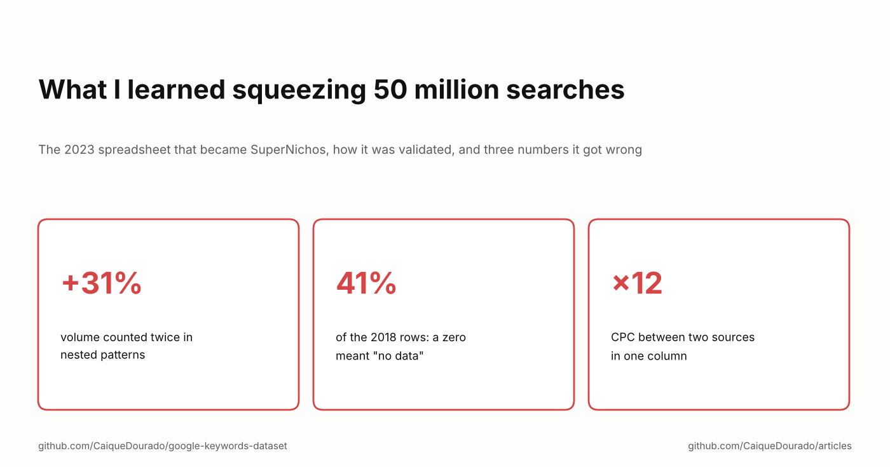
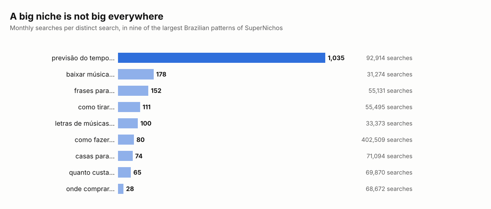

# What I learned squeezing 50 million searches

*The 2023 spreadsheet that became SuperNichos, how it was validated, and three numbers it got wrong.*

[Leia em português](README.pt-BR.md)

In September 2023 I published a blog post called "What I learned squeezing 50 million Google search terms". It took a
table of Brazilian searches with volume, competition and CPC, cut every word to its stem, took the first two to five
stems of each search as its pattern, and grouped: 50 million searches became 90 million pattern rows and then about
780 thousand patterns. *Quanto custa uma viagem para o Japão* gave `quant cust`, `quant cust viag` and so on, and
`quant cust` grouped every "how much does … cost" in the country.

[Part 1](../seven-ways-search-patterns/README.md) of this series is about that algorithm and its six siblings,
[part 2](../scale-search-patterns/README.md) about running it at scale, [part 3](../choosing-sites/README.md) about the
sites I chose with it. This one is about what happened to the spreadsheet, and what I see in it now that the data is
public.

## The spreadsheet was the validation

At the end of the post I shared 10,000 of the 780 thousand rows as a Google Sheet. It spread further than anything I
had written: comments, shares, retweets from SEO people I admired, some from outside Brazil. Almost every message asked
for one of two things:

- **the full spreadsheet**, all 700-something thousand niches;
- **the searches behind each pattern**, so a niche would come with its complete keyword list.

Eleven days later, on 3 October, I launched [SuperNichos.com](https://supernichos.com): the patterns and the 50
million searches in an online tool, where you filter niches by volume, competition and CPC and open the keyword list of
any of them. I did not design that product. The people who asked for the spreadsheet did: the two requests are the two
screens.

What I would keep from it:

- **Publish a sample of the data before building the product.** A free spreadsheet costs an afternoon, and the
  reaction tells you whether anyone cares and what they would pay for.
- **Read the requests as a spec.** Nobody asked for charts or AI. They asked for *more rows* and *the rows underneath*.
- **Ship the obvious version fast.** The data and the SQL already existed; the product was a screen on top of them.

## What the niches showed

Sorted by how many different searches they group, the biggest Brazilian patterns are not topics. They are how people
start a question: *como fazer* (how to make), *quanto custa* (how much is), *onde comprar* (where to buy), *qual o
melhor* (which is the best), *frases para* (quotes for). A pattern like that is not a niche, it is a page template that
crosses every niche.

The spreadsheet ranked them by total volume, and that hid the most useful number: how much each *distinct* search is
worth.

*Previsão do tempo* (weather forecast) has 92,914 different searches and about 1,035 searches a month for each: few
pages, each with real traffic. *Onde comprar* has 68,672 different searches at 28 each: a long tail where every page
fights for crumbs. *Como fazer* has the most searches of all, 402,509, and 80 each. Same column in the spreadsheet,
three very different businesses.

## Three numbers it got wrong

Opening the data in 2026 to publish it as the
[google-keywords-dataset](https://github.com/CaiqueDourado/google-keywords-dataset), I found three problems in the
way the 2023 spreadsheet added things up. None of them was visible in a spreadsheet.

**1. Volume counted twice.** Every search belongs to up to four patterns, one per prefix: *previsão do tempo para
amanhã* is in `previsa temp`, in `previsa temp par` and in `previsa temp par amanh`. Each pattern's total is right on
its own; adding patterns is not. In the public sample, the 14 `previsa temp…` rows add up to 125.8 million searches a
month, against 96.1 million for `previsa temp` alone: **31% counted twice.** A "niche" chosen by adding up its rows looks
bigger than it is.

**2. A zero meant "no data".** Most of the searches came from a 2018 export with Google Keyword Planner metrics. In it,
a volume of 0 meant the tool had no metric: 18.3 million of its 44.6 million rows, **41%**, and almost none of them
had competition or CPC either. The 2023 post took the average competition and CPC of each pattern, and an average
counts those zeros as real. In the public sample of 2018 searches, the average CPC is 3.10 counting the no-data rows
as zero and 5.30 without them, and competition 0.16 against 0.27: **about 40% too low**.

**3. Two CPC scales in one column.** The post credited DataForSEO for the 50 million searches. Most of them came from
that 2018 export; DataForSEO added about 10 million rows later, in four markets. The two sources do not record CPC on the same scale: among
Brazilian patterns of the sample, the median is 1.07 in the 2018 data and 0.09 in DataForSEO, **12 times apart**. A
ranking by CPC that mixes them ranks the source, not the niche.

The fixes are boring, which is the point: empty instead of zero, sums only over non-overlapping groups, CPC compared
within one source. The published dataset applies them and says so in its README.

*The numbers here come from the SuperNichos table (`padroes`); the algorithm tables of parts 1 to 3 were built
separately and their totals differ a little.*

## What I would tell myself in 2023

- **The sample was the best thing in the post.** Next time, share the data first and write the product later.
- **Show value per search next to total volume.** It separates a niche from a template.
- **Know what zero means in every column** before averaging it.
- **Keep the source on every row.** Two vendors are two scales, and the post should have said where the data came
  from.

**Links**

- The data: [google-keywords-dataset](https://github.com/CaiqueDourado/google-keywords-dataset) ([Kaggle](https://www.kaggle.com/datasets/caiquedourado/google-keywords-dataset)), including the SuperNichos pattern table
- The product: [SuperNichos.com](https://supernichos.com)
- The original 2023 post (PT): [O que aprendi debulhando 50 milhões de termos de busca no Google](https://caiquedourado.com.br/o-que-aprendi-debulhando-50-milhoes-de-termos-de-busca-no-google/)
- The series: [part 1](../seven-ways-search-patterns/README.md), [part 2](../scale-search-patterns/README.md), [part 3](../choosing-sites/README.md)
- More articles: [github.com/CaiqueDourado/articles](https://github.com/CaiqueDourado/articles)

*Caique Dourado has spent 20 years building crawlers, data pipelines and programmatic SEO in .NET and SQL Server.*
