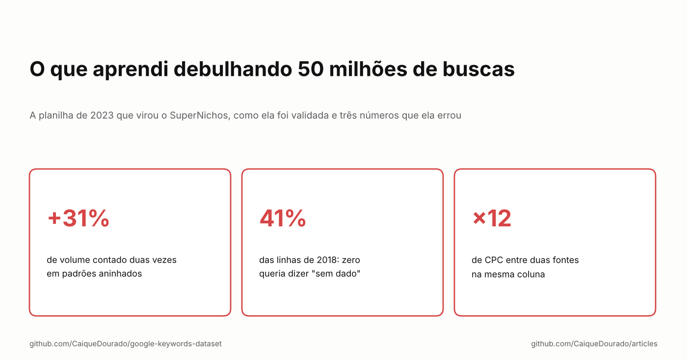
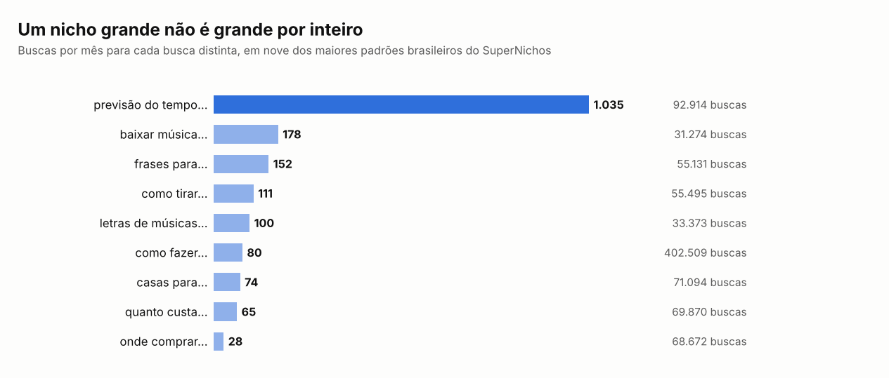

# O que aprendi debulhando 50 milhões de buscas

*A planilha de 2023 que virou o SuperNichos, como ela foi validada e três números que ela errou.*

[Read in English](README.md)

Em setembro de 2023 publiquei no blog "O que aprendi debulhando 50 milhões de termos de busca no Google". O post pegava
uma tabela de buscas brasileiras com volume, concorrência e CPC, reduzia cada palavra ao radical, usava as duas a cinco
primeiras palavras de cada busca como padrão e agrupava: 50 milhões de buscas viraram 90 milhões de linhas de padrão e
depois uns 780 mil padrões. *Quanto custa uma viagem para o Japão* gerava `quant cust`, `quant cust viag` e assim por
diante, e `quant cust` juntava todo "quanto custa …" do país.

A [parte 1](../seven-ways-search-patterns/README.pt-BR.md) desta série é sobre esse algoritmo e os seis irmãos dele, a
[parte 2](../scale-search-patterns/README.pt-BR.md) sobre rodá-lo em escala, a [parte 3](../choosing-sites/README.pt-BR.md)
sobre os sites que escolhi com ele. Esta é sobre o que aconteceu com a planilha, e o que eu vejo nela agora que os dados
são públicos.

## A planilha foi a validação

No fim do post compartilhei 10 mil das 780 mil linhas numa planilha do Google. Ela foi mais longe do que qualquer coisa
que eu tinha escrito: comentários, compartilhamentos, retuítes de gente de SEO que eu admirava, alguns de fora do
Brasil. Quase toda mensagem pedia uma de duas coisas:

- **a planilha completa**, com os 700 e tantos mil nichos;
- **as buscas por trás de cada padrão**, para cada nicho vir com a lista completa de palavras-chave.

Onze dias depois, em 3 de outubro, lancei o [SuperNichos.com](https://supernichos.com): os padrões e as 50 milhões de
buscas numa ferramenta online, em que se filtra nichos por volume, concorrência e CPC e se abre a lista de
palavras-chave de qualquer um deles. Não fui eu que desenhei esse produto. Foram as pessoas que pediram a planilha: os
dois pedidos são as duas telas.

O que eu guardaria disso:

- **Publique uma amostra dos dados antes de construir o produto.** Uma planilha grátis custa uma tarde, e a reação
  diz se alguém se importa e pelo que pagaria.
- **Leia os pedidos como especificação.** Ninguém pediu gráfico nem IA. Pediram *mais linhas* e *as linhas de baixo*.
- **Lance a versão óbvia rápido.** Os dados e o SQL já existiam; o produto era uma tela em cima deles.

## O que os nichos mostraram

Ordenados por quantas buscas diferentes agrupam, os maiores padrões brasileiros não são assuntos. São o jeito como as
pessoas começam uma pergunta: *como fazer*, *quanto custa*, *onde comprar*, *qual o melhor*, *frases para*. Um padrão
assim não é um nicho, é um modelo de página que atravessa todos os nichos.

A planilha ordenava pelo volume total, e isso escondia o número mais útil: quanto vale cada busca *distinta*.

*Previsão do tempo* tem 92.914 buscas diferentes e cerca de 1.035 buscas por mês em cada uma: poucas páginas, cada uma
com tráfego de verdade. *Onde comprar* tem 68.672 buscas diferentes com 28 cada: uma cauda longa em que toda página
briga por migalhas. *Como fazer* tem mais buscas do que todos, 402.509, e 80 em cada. A mesma coluna na planilha, três
negócios bem diferentes.

## Três números que ela errou

Abrindo os dados em 2026 para publicar a
[google-keywords-dataset](https://github.com/CaiqueDourado/google-keywords-dataset), achei três problemas no jeito como a
planilha de 2023 somava as coisas. Nenhum deles aparecia numa planilha.

**1. Volume contado duas vezes.** Cada busca entra em até quatro padrões, um por prefixo: *previsão do tempo para
amanhã* está em `previsa temp`, em `previsa temp par` e em `previsa temp par amanh`. O total de cada padrão está certo
sozinho; somar padrões, não. Na amostra pública, as 14 linhas `previsa temp…` somam 125,8 milhões de buscas por mês,
contra 96,1 milhões só de `previsa temp`: **31% contados duas vezes.** Um "nicho" escolhido somando as linhas dele
parece maior do que é.

**2. Zero queria dizer "sem dado".** A maior parte das buscas veio de uma exportação de 2018 com as métricas do
Planejador de Palavras-chave do Google. Nela, volume 0 queria dizer que a ferramenta não tinha a métrica: 18,3 milhões
das 44,6 milhões de linhas, **41%**, e quase nenhuma delas tinha concorrência ou CPC também. O post de 2023 tirava a
média de concorrência e de CPC de cada padrão, e uma média conta esses zeros como reais. Na amostra pública das buscas
de 2018, o CPC médio é 3,10 contando as linhas sem dado como zero e 5,30 sem elas, e a concorrência 0,16 contra 0,27:
**uns 40% abaixo**.

**3. Duas escalas de CPC na mesma coluna.** O post creditava ao DataForSEO as 50 milhões de buscas. A maioria veio
daquela exportação de 2018; o DataForSEO acrescentou uns 10 milhões de linhas depois, em quatro mercados. As duas fontes
não registram o CPC na mesma escala: entre os padrões brasileiros da amostra, a mediana é 1,07 nos dados de 2018 e 0,09
no DataForSEO, **12 vezes de diferença**. Um ranking por CPC que mistura as duas ordena a fonte, não o nicho.

As correções são chatas, e é isso que importa: vazio em vez de zero, somas só sobre grupos que não se sobrepõem, CPC
comparado dentro de uma fonte só. A base publicada aplica todas e diz isso no README.

*Os números aqui vêm da tabela do SuperNichos (`padroes`); as tabelas dos algoritmos das partes 1 a 3 foram montadas
separadamente e os totais delas diferem um pouco.*

## O que eu diria para mim mesmo em 2023

- **A amostra foi a melhor coisa do post.** Da próxima vez, compartilhe os dados primeiro e escreva o produto depois.
- **Mostre o valor por busca ao lado do volume total.** Ele separa um nicho de um modelo de página.
- **Saiba o que o zero quer dizer em cada coluna** antes de tirar a média.
- **Guarde a fonte em cada linha.** Dois fornecedores são duas escalas, e o post devia ter dito de onde vinham os dados.

**Links**

- Os dados: [google-keywords-dataset](https://github.com/CaiqueDourado/google-keywords-dataset) ([Kaggle](https://www.kaggle.com/datasets/caiquedourado/google-keywords-dataset)), com a tabela de padrões do SuperNichos
- O produto: [SuperNichos.com](https://supernichos.com)
- O post original de 2023: [O que aprendi debulhando 50 milhões de termos de busca no Google](https://caiquedourado.com.br/o-que-aprendi-debulhando-50-milhoes-de-termos-de-busca-no-google/)
- A série: [parte 1](../seven-ways-search-patterns/README.pt-BR.md), [parte 2](../scale-search-patterns/README.pt-BR.md), [parte 3](../choosing-sites/README.pt-BR.md)
- Mais artigos: [github.com/CaiqueDourado/articles](https://github.com/CaiqueDourado/articles)

*Caique Dourado constrói há 20 anos crawlers, pipelines de dados e SEO programático em .NET e SQL Server.*
