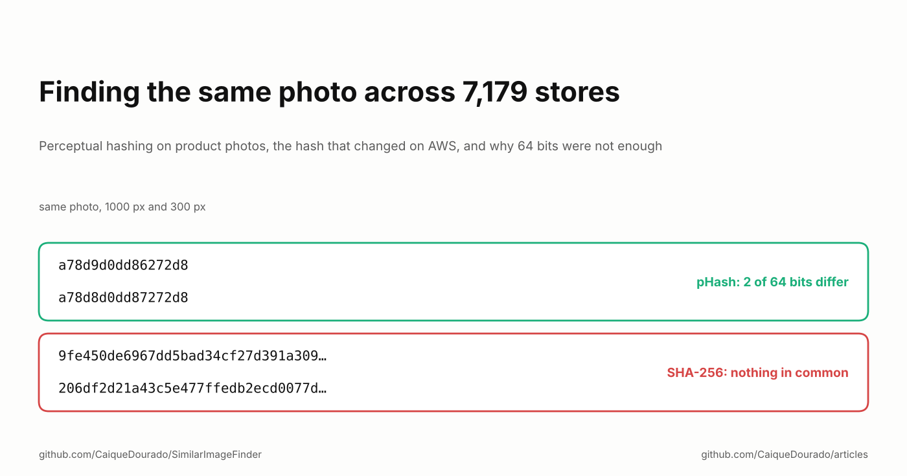
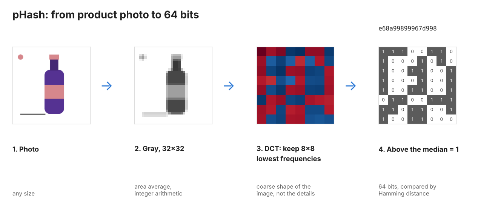
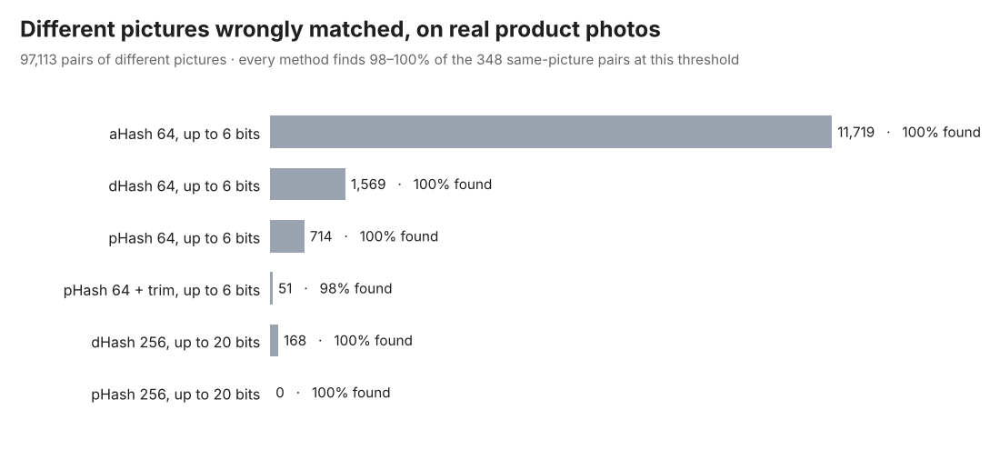

# Finding the same photo across 7,179 stores

*Perceptual hashing on product photos, the hash that changed on AWS, and why 64 bits were not enough.*

[Leia em português](README.pt-BR.md)

The price-comparison catalog I ran from 2019 to 2024 collected 114.6 million offers from 7,179 Brazilian online
stores. Names were one way to tell that two offers were the same product ([the previous article](../text-similarity/README.md)
is about that). Photos were another: many stores sell the same product with the same photo, sent by the
manufacturer or copied from each other.

Every photo was downloaded (85.8 million download jobs on 12 to 15 machines), shrunk to 16×16 gray and hashed with
SHA-256. That signature became one of the 12 keys that linked offers. This article is what that signature got right,
the two things it got wrong, and what I measured when I rebuilt it as an open library,
[SimilarImageFinder](https://github.com/CaiqueDourado/SimilarImageFinder).

## What the exact signature got right

Two things, both useful:

- **Sister stores.** Stores on the same platform, or from the same group, serve the very same image file. Same
  file, same signature, same product.
- **Placeholders.** A signature found on more than 100 products was almost always a "no photo" image or a store logo.
  Those signatures were flagged and stopped linking products; otherwise every product without a photo in a store
  would have been "the same product".

## Mistake 1: it only matched identical files

A cryptographic hash answers "are these two files identical?". Change one pixel by one gray level and every byte of
the hash changes. A store that resized the manufacturer's photo, or saved it again as JPEG, produced a new signature:

On 442 real photos from the catalog (shoes, sandals, wallets and belts, as the crawler saved them, from 150 to 724
pixels, in JPEG and PNG), there are 348 pairs of files that show the same picture. The exact signature found **20 of
them: 5.7%**.

A **perceptual hash** answers a different question: "do these two images look the same?". pHash shrinks the image to
32×32 gray, keeps only its coarse shapes (the lowest frequencies of a discrete cosine transform), and writes one bit
per frequency: above or below the median. Resizing and compression change details, not coarse shapes, so the bits
barely move. Two images are compared by counting differing bits.

## Mistake 2: the hash changed on AWS

When the image pipeline moved to AWS and the photos were hashed again, the new signatures did not match the ones
computed on the local machines. The old code hashed the **encoded** 16×16 thumbnail file, and the bytes of an
encoded image can change with the encoder version even when the picture is the same. That is the most likely
cause. The lesson is general: **hash pixels, not files**. SimilarImageFinder decodes the image, computes every step
with integer arithmetic and gets the same bits in Python and .NET, on any machine. A shared set of test vectors
checks it on every build.

## Which perceptual hash

There are three classic perceptual hashes: aHash (each pixel against the average), dHash (each pixel against its
neighbour) and pHash (the cosine transform). On 300 synthetic product photos, each with 11 edits that stores make,
and 44,850 pairs of *different* products, they behave very differently:

Product photos are hard for perceptual hashes: a white background and an object in the middle. Most of the bits of
aHash and dHash end up describing the background, so at 6 bits 7.7% (aHash) and 1.9% (dHash) of the pairs of
different products look like duplicates. pHash keeps it at 0.22%.

## Why 64 bits were not enough

The synthetic photos have no texture or shadow, so I measured again on the real photos:

Every method finds the copies. What changes is how many **different** pictures each one also matches: 11,719 pairs
with aHash, 714 with pHash at 64 bits. Two different shoes photographed in the same pose on white can get **the same
64-bit hash**: 64 bits only describe the outline.

With 256 bits (`hash_size=16`), the farthest pair of copies was 14 bits apart and the closest pair of different
pictures was 30. A threshold of 20 separates them with room on both sides, and the 256-bit pHash matched no
different pictures at all. The closest different pictures were colour variants of one model, the brown and the black
version of the same shoe, shot the same way. For a catalog that is the right answer: they are different products.

One caveat about my own number: the labels of the real photos were built starting from pHash 256 candidates and then
checked by eye, so its recall is close to 100% partly by construction. The false matches of the other methods do not
depend on that.

The 256-bit hash is stricter the other way too: it still finds every resize, recompression and brightness change, but
no longer finds crops, added borders, watermarks or small rotations. There is no free setting:

- **Product photos, copies across stores:** pHash with 256 bits and a distance of about 20.
- **Edited copies (crops, borders, watermarks):** 64 bits and a distance of 6 to 8, and confirm the match with
  another signal, because different products will match.
- **Trimming the border** helps when the background is plain and the margins vary, and hurts when the background is a
  grey studio gradient: one copy gets trimmed and the other does not.

## Searching millions of hashes

Comparing every hash with every other one does not scale to a catalog. SimilarImageFinder uses multi-index hashing:
cut the 64 bits into four bands of 16; if two hashes are within 6 bits, at least one band is within 1 bit. A query
looks up each band and its one-bit variants, then checks only those candidates. The search is exact. On 1,050,000
hashes, a query takes 0.4 ms in .NET and 0.6 ms in Python on a 2-core cloud VM.

## What I would tell myself in 2019

- **Hash decoded pixels with integer math**, and keep test vectors, or the same photo will get two hashes on two
  machines.
- **Use a perceptual hash, and measure it on your own kind of image.** Product photos on white break aHash and dHash.
- **More bits for catalogs.** 256 bits keep colour variants and look-alike products apart.
- **A photo is a signal, not proof.** In the catalog, the image signature was one of 12 keys, next to barcodes and
  names, and [DedupKit](https://github.com/CaiqueDourado/DedupKit) still refuses a photo match when the names state
  different sizes or colours.

**Links**

- The library: [SimilarImageFinder](https://github.com/CaiqueDourado/SimilarImageFinder) (Python and .NET, same bits in both)
- Matching by name: [Metaphone, Soundex, n-grams and MinHash on Brazilian product names](../text-similarity/README.md) and [DedupKit](https://github.com/CaiqueDourado/DedupKit)
- The catalog: [brazilian-ecommerce-products](https://github.com/CaiqueDourado/brazilian-ecommerce-products) ([Kaggle](https://www.kaggle.com/datasets/caiquedourado/catalogo-produtos-ecommerce-brasil))
- More articles: [github.com/CaiqueDourado/articles](https://github.com/CaiqueDourado/articles)

*Caique Dourado has spent 20 years building crawlers, data pipelines and programmatic SEO in .NET and SQL Server.*
