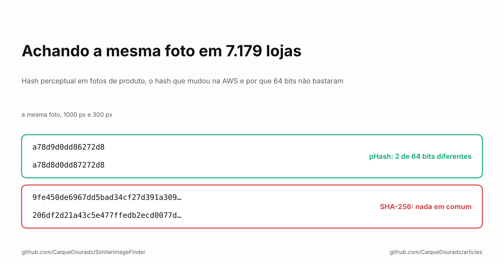
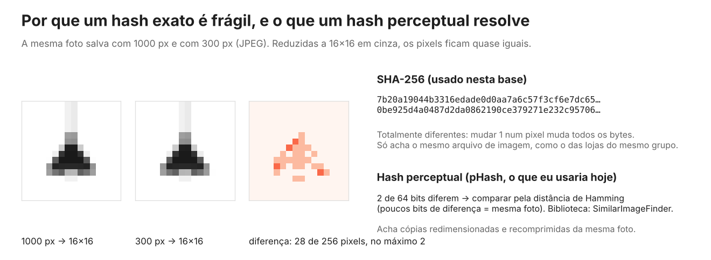
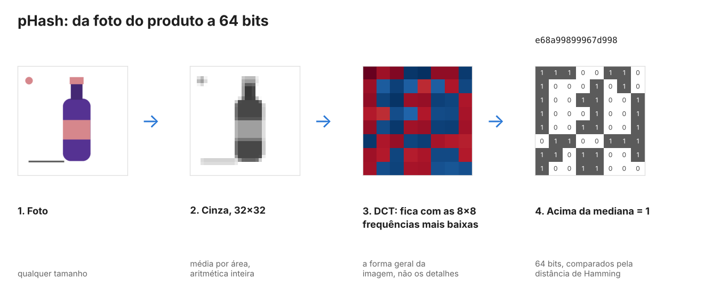
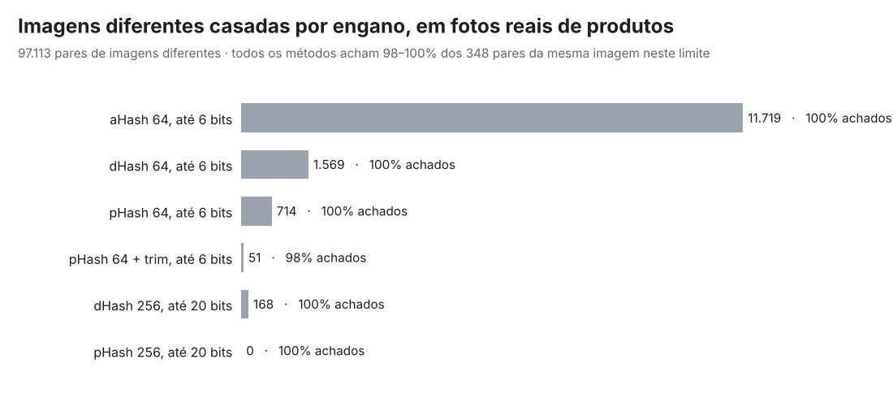

# Achando a mesma foto em 7.179 lojas

*Hash perceptual em fotos de produto, o hash que mudou na AWS e por que 64 bits não bastaram.*

[Read in English](README.md) · [Em inglês no Medium](https://medium.com/@caiquedourado/finding-the-same-photo-across-7-179-stores-a4e94bc93777)

O catálogo de comparação de preços que mantive de 2019 a 2024 coletou 114,6 milhões de ofertas de 7.179 lojas online
brasileiras. O nome era um jeito de saber que duas ofertas eram o mesmo produto ([o artigo anterior](../text-similarity/README.pt-BR.md)
é sobre isso). A foto era outro: muitas lojas vendem o mesmo produto com a mesma foto, enviada pelo fabricante ou
copiada uma da outra.

Toda foto era baixada (85,8 milhões de tarefas de download em 12 a 15 máquinas), reduzida a 16×16 em tons de cinza e
passada num SHA-256. Essa assinatura virou uma das 12 chaves que ligavam as ofertas. Este artigo é o que essa
assinatura acertou, as duas coisas que errou e o que medi quando a reconstruí como biblioteca aberta, o
[SimilarImageFinder](https://github.com/CaiqueDourado/SimilarImageFinder).

## O que a assinatura exata acertou

Duas coisas, as duas úteis:

- **Lojas irmãs.** Lojas da mesma plataforma, ou do mesmo grupo, servem exatamente o mesmo arquivo de imagem. Mesmo
  arquivo, mesma assinatura, mesmo produto.
- **Imagens genéricas.** Uma assinatura presente em mais de 100 produtos era quase sempre uma imagem de "sem foto" ou
  o logo da loja. Essas assinaturas eram marcadas e deixavam de ligar produtos; senão, todo produto sem foto de uma
  loja seria "o mesmo produto".

## Erro 1: só achava arquivos idênticos

Um hash criptográfico responde "esses dois arquivos são idênticos?". Mude um pixel em um tom de cinza e todos os
bytes do hash mudam. Uma loja que redimensionou a foto do fabricante, ou salvou de novo em JPEG, gerava uma
assinatura nova:

Em 442 fotos reais do catálogo (sapatos, sandálias, carteiras e cintos, do jeito que o crawler salvou, de 150 a 724
pixels, em JPEG e PNG), há 348 pares de arquivos que mostram a mesma imagem. A assinatura exata achou **20 deles:
5,7%**.

Um **hash perceptual** responde outra pergunta: "essas duas imagens parecem iguais?". O pHash reduz a imagem a 32×32
em cinza, guarda só as formas grossas (as frequências mais baixas de uma transformada de cosseno) e escreve um bit por
frequência: acima ou abaixo da mediana. Redimensionar e comprimir mudam os detalhes, não as formas grossas, então os
bits quase não se mexem. Duas imagens são comparadas contando os bits diferentes.

## Erro 2: o hash mudou na AWS

Quando o processamento de imagens foi para a AWS e as fotos foram processadas de novo, as assinaturas novas não
batiam com as calculadas nas máquinas locais. O código antigo calculava o hash do **arquivo codificado** da miniatura
16×16, e os bytes de uma imagem codificada podem mudar com a versão do codificador mesmo quando a imagem é a mesma.
Essa é a causa mais provável. A lição vale para qualquer caso: **faça o hash dos pixels, não do arquivo**. O
SimilarImageFinder decodifica a imagem, faz cada passo com aritmética de inteiros e chega aos mesmos bits em Python e
em .NET, em qualquer máquina. Um conjunto de vetores de teste compartilhado confere isso a cada build.

## Qual hash perceptual

Há três hashes perceptuais clássicos: aHash (cada pixel contra a média), dHash (cada pixel contra o vizinho) e pHash
(a transformada de cosseno). Em 300 fotos sintéticas de produto, cada uma com 11 edições que lojas fazem, e 44.850
pares de produtos *diferentes*, eles se comportam de jeitos bem diferentes:

Foto de produto é difícil para hash perceptual: fundo branco e um objeto no meio. A maior parte dos bits do aHash e do
dHash acaba descrevendo o fundo, então a 6 bits 7,7% (aHash) e 1,9% (dHash) dos pares de produtos diferentes parecem
duplicados. O pHash fica em 0,22%.

## Por que 64 bits não bastaram

As fotos sintéticas não têm textura nem sombra, então medi de novo nas fotos reais:

Todos os métodos acham as cópias. O que muda é quantas imagens **diferentes** cada um também junta: 11.719 pares com
aHash, 714 com pHash de 64 bits. Dois sapatos diferentes fotografados na mesma pose sobre fundo branco podem ter **o
mesmo hash de 64 bits**: 64 bits só descrevem o contorno.

Com 256 bits (`hash_size=16`), o par de cópias mais distante ficou a 14 bits e o par de imagens diferentes mais
próximo, a 30. Um corte em 20 separa os dois com folga dos dois lados, e o pHash de 256 bits não juntou nenhuma imagem
diferente. As imagens diferentes mais próximas eram variações de cor do mesmo modelo, o marrom e o preto do mesmo
sapato, fotografados do mesmo jeito. Para um catálogo, essa é a resposta certa: são produtos diferentes.

Uma ressalva sobre o meu próprio número: os rótulos das fotos reais foram montados a partir dos candidatos do pHash
256 e depois conferidos no olho, então a revocação dele é perto de 100% em parte por construção. Os erros dos outros
métodos não dependem disso.

O hash de 256 bits também é mais rígido no outro sentido: continua achando todo redimensionamento, recompressão e
mudança de brilho, mas deixa de achar recortes, bordas acrescentadas, marcas d'água e pequenas rotações. Não existe
ajuste de graça:

- **Fotos de produto, cópias entre lojas:** pHash com 256 bits e distância de cerca de 20.
- **Cópias editadas (recorte, borda, marca d'água):** 64 bits e distância de 6 a 8, confirmando com outro sinal,
  porque produtos diferentes vão bater.
- **Cortar a borda** ajuda quando o fundo é liso e as margens variam, e atrapalha quando o fundo é um degradê cinza de
  estúdio: uma cópia é cortada e a outra não.

## Buscando em milhões de hashes

Comparar cada hash com todos os outros não escala para um catálogo. O SimilarImageFinder usa indexação em várias
partes (multi-index hashing): corta os 64 bits em quatro faixas de 16; se dois hashes estão a até 6 bits, pelo menos
uma faixa está a até 1 bit. A busca olha cada faixa e as variações de um bit e só confere esses candidatos. A busca é
exata. Com 1.050.000 hashes, uma consulta leva 0,4 ms em .NET e 0,6 ms em Python, numa VM de nuvem com 2 núcleos.

## O que eu diria para mim mesmo em 2019

- **Faça o hash dos pixels decodificados, com aritmética de inteiros**, e guarde vetores de teste, ou a mesma foto
  vai ter dois hashes em duas máquinas.
- **Use hash perceptual, e meça no seu tipo de imagem.** Foto de produto em fundo branco quebra o aHash e o dHash.
- **Mais bits para catálogo.** 256 bits mantêm separadas as variações de cor e os produtos parecidos.
- **Foto é um sinal, não prova.** No catálogo, a assinatura da imagem era uma de 12 chaves, ao lado de código de
  barras e nome, e o [DedupKit](https://github.com/CaiqueDourado/DedupKit) ainda recusa um par pela foto quando os
  nomes trazem tamanhos ou cores diferentes.

**Links**

- A biblioteca: [SimilarImageFinder](https://github.com/CaiqueDourado/SimilarImageFinder) (Python e .NET, mesmos bits nos dois)
- Agrupando pelo nome: [Metaphone, Soundex, n-gramas e MinHash em nomes de produtos brasileiros](../text-similarity/README.pt-BR.md) e [DedupKit](https://github.com/CaiqueDourado/DedupKit)
- O catálogo: [brazilian-ecommerce-products](https://github.com/CaiqueDourado/brazilian-ecommerce-products) ([Kaggle](https://www.kaggle.com/datasets/caiquedourado/catalogo-produtos-ecommerce-brasil))
- Mais artigos: [github.com/CaiqueDourado/articles](https://github.com/CaiqueDourado/articles)

*Caique Dourado constrói há 20 anos crawlers, pipelines de dados e SEO programático em .NET e SQL Server.*
