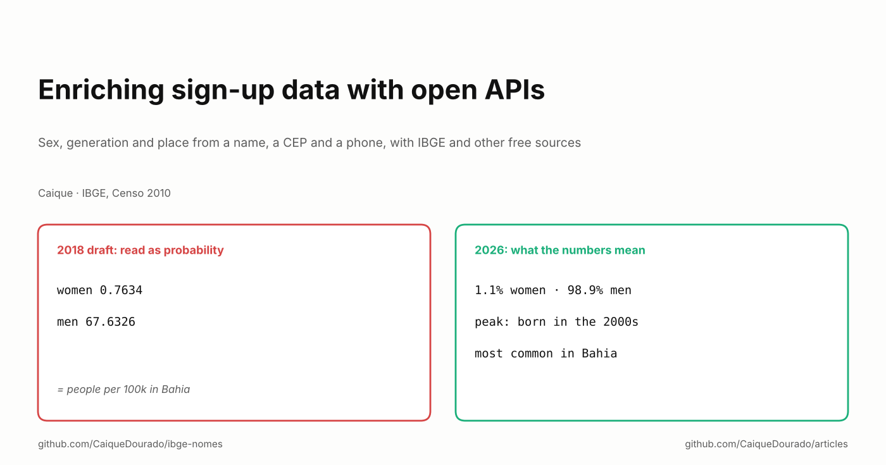
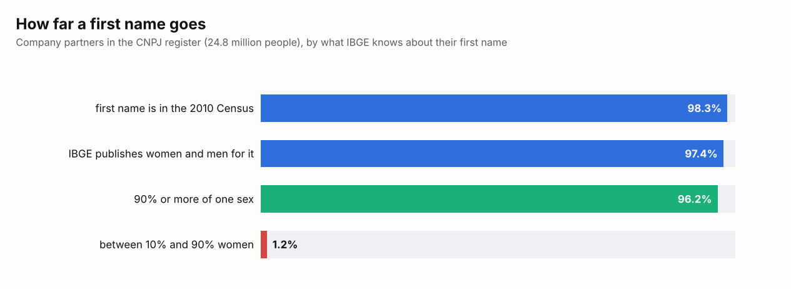

# Enriching sign-up data with open APIs

*Sex, generation and place from a name, a CEP and a phone, with IBGE and other free sources.*

[Leia em português](README.pt-BR.md)

In March 2018 I started a blog post called "Enriching sign-up data with open APIs". It never got past one paragraph:
the IBGE Census names API "can be useful to classify the gender of contacts by their name", with my own name as the
example: *women 0.7634, men 67.6326*.

Those two numbers are not probabilities. They do not even add up to 100. They add up to exactly 68.396, which is the
`ufMaxProp` of the unfiltered answer: people named Caique per 100,000 inhabitants of Bahia, the state where the name
is most common, split into women and men. The share of women is 0.7634 / 68.396 = 1.1%. The idea was right and the
reading was wrong, and nothing in the answer said so.

This article is the post I meant to write, eight years later, after using these sources for real: in the
[names dataset](https://github.com/CaiqueDourado/brazilian-names-surnames), in the
[municipalities table](https://github.com/CaiqueDourado/municipios-e-estados-do-brasil) behind my programmatic sites,
and in three open libraries.

## What a sign-up form already tells you

A typical Brazilian sign-up has a name, an e-mail, a phone, a CEP (postal code), maybe a CPF or CNPJ and a city typed by
hand. With free public sources and no extra question to the customer, those fields give:

| Field | What it adds | Source |
|---|---|---|
| First name | likely sex, generation, the state where the name is common | IBGE names API (2010 Census) |
| CEP | state | Correios numeric ranges, offline |
| Phone | valid or not, mobile or landline, state from the area code (DDD) | the 67 DDDs, offline |
| City typed by hand | IBGE code, and through it population, region, time zone | IBGE Localidades and SIDRA |
| CPF / CNPJ | valid or not, head office or branch | check digits, offline |

Half of the table needs no API at all. That is the first lesson: **call an API only for what you cannot compute.**

## From a first name: sex and generation

IBGE's names API answers, for each first name counted in the 2010 Census, how many people had it, where it is most
common, and, in its v2 endpoint, how many were women and men and in which decade they were born. No key, no login. I
wrote [ibge-nomes](https://github.com/CaiqueDourado/ibge-nomes), a Python client, to fill the dataset, and the decade
answer alone tells a story:

Maria peaked among people born in the 1950s and 1960s. Caique barely existed before the 1990s. A customer named Caique
is almost certainly under 40; a customer named Maria could be any age. That is a better default for a segment than
nothing, and much better than a guess.

How far does this go on a real list of Brazilian adults? The CNPJ register lists 24.8 million company partners, and the
names dataset counts them by first name:

98.3% of the partners have a first name the Census counted, and 96.2% have a name that is at least 90% one sex. Only
1.2% have a truly mixed name: Darci (33% women), Eli (41%), Jaci (60%), Lucimar (83%), Nadir (89%). Note the pattern:
most of them peaked among people born between the 1950s and the 1980s.

Things the answer does not tell you, and I learned the hard way:

- **Counts are per spelling.** Caique 50,902, Kaique 43,883, Cayque 475. The `nomes` field only lists related
  spellings; it does not add them up.
- **First names only.** Compound names ("Maria Júlia") have no data. Use the first word.
- **Not every name has every answer.** Of 24,751 names with a Census rank, the v2 endpoint answered for 17,200. Small
  counts are not published, so a missing decade means "few", not "zero".
- **It is 2010.** Names given after 2010 are not there, and the people counted were alive in 2010.

And one rule that is not technical: a sex inferred from a name is an estimate about a person. Keep it as a share
(`share_female = 0.011`), use it for segments and aggregates, and never as a fact on someone's record.

## From a CEP, a phone and a city: place

**CEP and phone need no API.** The first digits of a CEP map to a state through the Correios ranges, and a phone's area
code maps to a state too. [PtBr.Text](https://github.com/CaiqueDourado/PtBr.Text) does both offline, together with the
messy part: phones typed as `0 21 11 3456-7890`, with trunk and carrier codes, validated against the 67 DDDs. When the
CEP says one state and the DDD another, that is a signal worth keeping, not an error to fix: people move and keep their
numbers.

**A city typed by hand needs a key.** Matching the text to an IBGE code is harder than it looks. 241 municipality names
are shared by 523 municipalities: there are six Bom Jesus (PI, RN, PB, SC, RS, GO) and five São Domingos. The name alone
is not a key; name plus state is. And the borders are not tidy: Barracão (PR) uses area code 49, from Santa Catarina,
because it is a twin town of Dionísio Cerqueira (SC).

Once a record has an IBGE code, every government table joins to it. The
[municipalities table](https://github.com/CaiqueDourado/municipios-e-estados-do-brasil) already carries what I needed
most often:

- **2022 Census population, area and density**, from IBGE SIDRA, to tell a capital from a town of 2,000 people.
- **Region and IBGE's regional divisions**, for reports that do not stop at the state.
- **The IANA time zone**, so a message goes out at 9 a.m. in Manaus and not at 8. Brazil uses 15 canonical zones. The
  export I started from used four names: offsets right today, history wrong, because the states had different daylight
  saving rules until 2019. 2,389 municipalities had to be fixed.
- **The grammar of the state name**, "no Acre", "na Bahia", "em Goiás", so a template writes the sentence right.

## Being a good citizen of a free API

Free public APIs are run by small teams on modest servers. The collectors that filled these datasets follow the same
rules:

- **Cache every raw answer on disk.** A rerun costs no calls, a stopped run resumes where it stopped, and the build can
  be reproduced offline. The raw answers are versioned in the repositories.
- **Batch and wait.** The IBGE v2 endpoint takes several names in one call: 20 per call, 0.2 s between calls. A batch the
  server refuses is retried one name at a time.
- **Respect the quota.** Open-Meteo's free tier gets 100 coordinates every 15 seconds, and an HTTP 429 is answered by
  waiting what `Retry-After` says.
- **Identify yourself** in the User-Agent.
- **Never turn off TLS verification.** Some government servers send an incomplete certificate chain. The fix is the
  operating system's trust store (`truststore` in Python), not `verify=False`.
- **Plan for the source to go away.** In October 2026 the CPTEC city list was down on BrasilAPI (HTTP 500) and on CPTEC
  itself (HTTP 403). The table shipped without that column instead of waiting.

## What I would tell myself in 2018

- **Read the field, not the number.** A number that looks like a probability is not one until the documentation says
  so. Two shares that do not add up to 100 are a warning.
- **Compute first, call second.** CEP, DDD, CPF and CNPJ need no network.
- **Join on codes, never on names.** The IBGE code is the key that opens every other public table.
- **Keep the answers.** A cache of raw answers is the difference between a script and a dataset someone else can check.

**Links**

- The libraries: [ibge-nomes](https://github.com/CaiqueDourado/ibge-nomes) (Python) and [PtBr.Text](https://github.com/CaiqueDourado/PtBr.Text) (.NET: CEP, DDD, phones, CPF and CNPJ, including the 2026 alphanumeric CNPJ)
- The data: [brazilian-names-surnames](https://github.com/CaiqueDourado/brazilian-names-surnames) and [municipios-e-estados-do-brasil](https://github.com/CaiqueDourado/municipios-e-estados-do-brasil) ([Kaggle](https://www.kaggle.com/datasets/caiquedourado/municipios-e-estados-do-brasil))
- The API: [servicodados.ibge.gov.br/api/docs/nomes](https://servicodados.ibge.gov.br/api/docs/nomes)
- Previous article: [Sentence splitting + sentiment analysis = pros and cons](../pros-and-cons/README.md)
- More articles: [github.com/CaiqueDourado/articles](https://github.com/CaiqueDourado/articles)

*Caique Dourado has spent 20 years building crawlers, data pipelines and programmatic SEO in .NET and SQL Server.*
