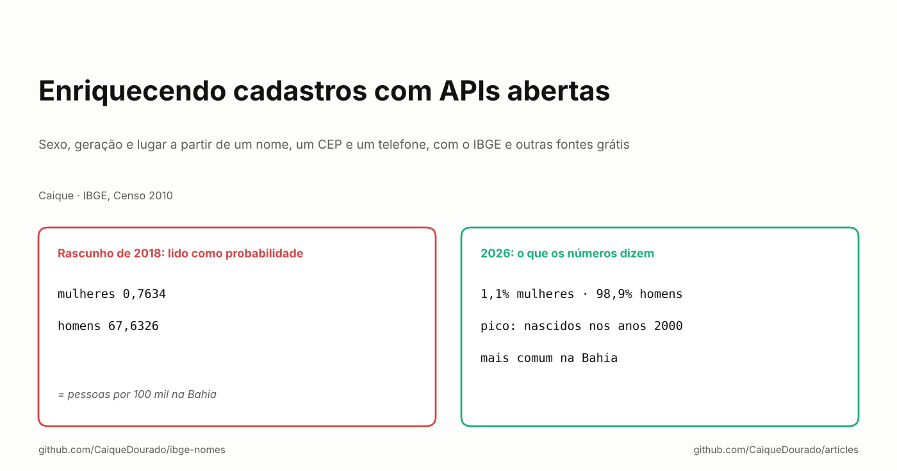
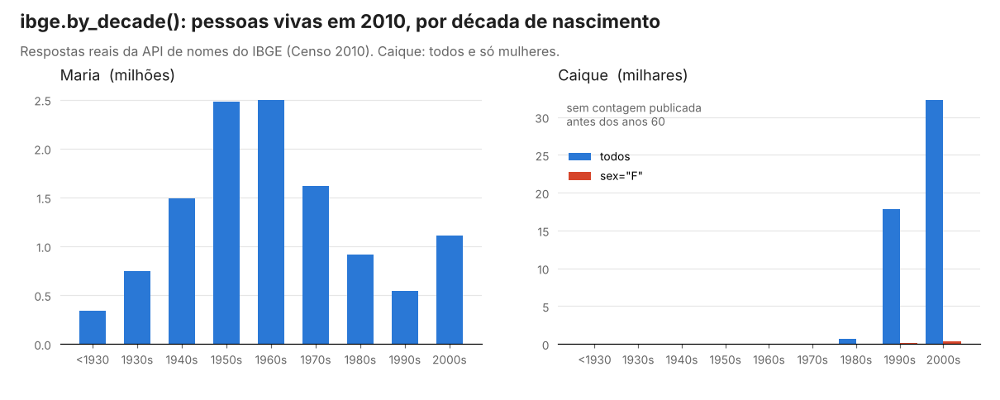
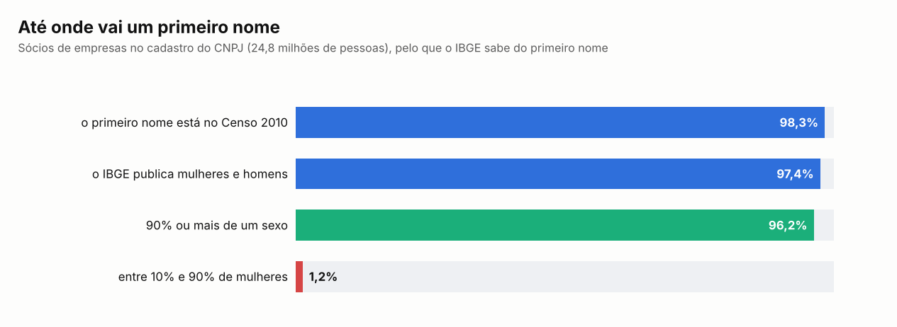

# Enriquecendo cadastros com APIs abertas

*Sexo, geração e lugar a partir de um nome, um CEP e um telefone, com o IBGE e outras fontes grátis.*

[Read in English](README.md)

Em março de 2018 comecei um post chamado "Enriquecendo informações de cadastro com dados de APIs abertas". Ele não passou
de um parágrafo: a API de nomes do Censo do IBGE "pode ser útil para classificar o gênero dos contatos, de acordo com o
nome", com o meu nome de exemplo: *feminino 0,7634, masculino 67,6326*.

Esses dois números não são probabilidades. Nem somam 100. Somam exatamente 68,396, que é o `ufMaxProp` da resposta sem
filtro: pessoas chamadas Caique a cada 100 mil habitantes da Bahia, o estado onde o nome é mais comum, separadas em
mulheres e homens. A parte de mulheres é 0,7634 / 68,396 = 1,1%. A ideia estava certa e a leitura estava errada, e
nada na resposta avisava.

Este artigo é o post que eu queria ter escrito, oito anos depois, depois de usar essas fontes de verdade: na
[base de nomes](https://github.com/CaiqueDourado/brazilian-names-surnames), na
[tabela de municípios](https://github.com/CaiqueDourado/municipios-e-estados-do-brasil) por trás dos meus sites
programáticos e em três bibliotecas abertas.

## O que um cadastro já conta

Um cadastro brasileiro típico tem nome, e-mail, telefone, CEP, às vezes CPF ou CNPJ e uma cidade digitada à mão. Com
fontes públicas grátis, sem nenhuma pergunta a mais para o cliente, esses campos dão:

| Campo | O que acrescenta | Fonte |
|---|---|---|
| Primeiro nome | sexo provável, geração, estado onde o nome é comum | API de nomes do IBGE (Censo 2010) |
| CEP | estado | faixas numéricas dos Correios, offline |
| Telefone | válido ou não, celular ou fixo, estado pelo DDD | os 67 DDDs, offline |
| Cidade digitada | código IBGE e, por ele, população, região, fuso horário | IBGE Localidades e SIDRA |
| CPF / CNPJ | válido ou não, matriz ou filial | dígitos verificadores, offline |

Metade da tabela não precisa de API nenhuma. Essa é a primeira lição: **chame uma API só para o que você não consegue
calcular.**

## Do primeiro nome: sexo e geração

A API de nomes do IBGE responde, para cada primeiro nome contado no Censo 2010, quantas pessoas tinham o nome, onde ele
é mais comum e, no endpoint v2, quantas eram mulheres e homens e em que década nasceram. Sem chave, sem login. Escrevi o
[ibge-nomes](https://github.com/CaiqueDourado/ibge-nomes), um cliente em Python, para preencher a base, e só a
resposta por década já conta uma história:

Maria teve o pico entre os nascidos nos anos 1950 e 1960. Caique quase não existia antes dos anos 1990. Um cliente
chamado Caique quase certamente tem menos de 40 anos; uma cliente chamada Maria pode ter qualquer idade. Para um
segmento, é um ponto de partida melhor do que nada, e muito melhor do que um chute.

Até onde isso vai numa lista real de adultos brasileiros? O cadastro do CNPJ tem 24,8 milhões de sócios de empresas, e
a base de nomes conta esses sócios por primeiro nome:

98,3% dos sócios têm um primeiro nome que o Censo contou, e 96,2% têm um nome que é pelo menos 90% de um sexo. Só 1,2%
têm um nome de fato misto: Darci (33% mulheres), Eli (41%), Jaci (60%), Lucimar (83%), Nadir (89%). Repare no padrão:
a maioria teve o pico entre os nascidos dos anos 1950 aos 1980.

O que a resposta não conta, e eu aprendi do jeito difícil:

- **A contagem é por grafia.** Caique 50.902, Kaique 43.883, Cayque 475. O campo `nomes` só lista grafias parecidas;
  ele não soma.
- **Só primeiro nome.** Nomes compostos ("Maria Júlia") não têm dados. Use a primeira palavra.
- **Nem todo nome tem toda resposta.** Dos 24.751 nomes com posição no Censo, o endpoint v2 respondeu para 17.200.
  Contagens pequenas não são publicadas, então uma década faltando quer dizer "poucos", não "zero".
- **É 2010.** Nomes dados depois de 2010 não estão lá, e as pessoas contadas eram as vivas em 2010.

E uma regra que não é técnica: o sexo inferido pelo nome é uma estimativa sobre uma pessoa. Guarde como proporção
(`share_female = 0,011`), use para segmentos e agregados, e nunca como fato no cadastro de alguém.

## Do CEP, do telefone e da cidade: lugar

**CEP e telefone não precisam de API.** Os primeiros dígitos do CEP levam ao estado pelas faixas dos Correios, e o DDD
do telefone também. O [PtBr.Text](https://github.com/CaiqueDourado/PtBr.Text) faz os dois offline, junto com a parte
bagunçada: telefones digitados como `0 21 11 3456-7890`, com zero de tronco e código de operadora, validados contra os
67 DDDs. Quando o CEP diz um estado e o DDD diz outro, isso é um sinal para guardar, não um erro para corrigir: as
pessoas se mudam e mantêm o número.

**A cidade digitada à mão precisa de uma chave.** Casar o texto com um código IBGE é mais difícil do que parece. 241
nomes de município são usados por 523 municípios: há seis Bom Jesus (PI, RN, PB, SC, RS, GO) e cinco São Domingos. O
nome sozinho não é chave; nome mais estado é. E as divisas não são arrumadas: Barracão (PR) usa o DDD 49, de Santa
Catarina, porque é cidade gêmea de Dionísio Cerqueira (SC).

Com o código IBGE no cadastro, toda tabela do governo se junta a ele. A
[tabela de municípios](https://github.com/CaiqueDourado/municipios-e-estados-do-brasil) já traz o que eu mais precisei:

- **População, área e densidade do Censo 2022**, do SIDRA do IBGE, para separar uma capital de uma cidade de 2 mil
  habitantes.
- **Região e as divisões regionais do IBGE**, para relatórios que não param no estado.
- **O fuso horário IANA**, para uma mensagem sair às 9h em Manaus e não às 8h. O Brasil usa 15 fusos canônicos. A
  exportação de onde parti usava quatro nomes: o deslocamento certo hoje, a história errada, porque os estados tinham
  regras de horário de verão diferentes até 2019. Foram 2.389 municípios corrigidos.
- **A gramática do nome do estado**, "no Acre", "na Bahia", "em Goiás", para um modelo de texto escrever a frase certa.

## Sendo um bom cidadão de uma API grátis

APIs públicas grátis são mantidas por equipes pequenas, em servidores modestos. Os coletores que preencheram essas bases
seguem as mesmas regras:

- **Guarde cada resposta bruta em disco.** Rodar de novo não custa chamadas, uma execução interrompida continua de
  onde parou e a base pode ser refeita offline. As respostas brutas estão versionadas nos repositórios.
- **Agrupe e espere.** O endpoint v2 do IBGE aceita vários nomes numa chamada: 20 por chamada, 0,2 s entre chamadas.
  Um lote recusado pelo servidor é tentado de novo um nome por vez.
- **Respeite a cota.** O plano grátis do Open-Meteo aceita 100 coordenadas a cada 15 segundos, e um HTTP 429 é
  respondido esperando o que o `Retry-After` diz.
- **Identifique-se** no User-Agent.
- **Nunca desligue a verificação de TLS.** Alguns servidores do governo mandam a cadeia de certificados incompleta. A
  solução é o repositório de certificados do sistema operacional (`truststore` em Python), não `verify=False`.
- **Conte com a fonte sumindo.** Em outubro de 2026 a lista de cidades do CPTEC estava fora do ar na BrasilAPI (HTTP
  500) e no próprio CPTEC (HTTP 403). A tabela saiu sem essa coluna em vez de esperar.

## O que eu diria para mim mesmo em 2018

- **Leia o campo, não o número.** Um número com cara de probabilidade só é probabilidade quando a documentação diz.
  Duas proporções que não somam 100 são um aviso.
- **Calcule primeiro, chame depois.** CEP, DDD, CPF e CNPJ não precisam de rede.
- **Junte por código, nunca por nome.** O código IBGE é a chave que abre todas as outras tabelas públicas.
- **Guarde as respostas.** Um cache das respostas brutas é a diferença entre um script e uma base que outra pessoa
  consegue conferir.

**Links**

- As bibliotecas: [ibge-nomes](https://github.com/CaiqueDourado/ibge-nomes) (Python) e [PtBr.Text](https://github.com/CaiqueDourado/PtBr.Text) (.NET: CEP, DDD, telefones, CPF e CNPJ, inclusive o CNPJ alfanumérico de 2026)
- Os dados: [brazilian-names-surnames](https://github.com/CaiqueDourado/brazilian-names-surnames) e [municipios-e-estados-do-brasil](https://github.com/CaiqueDourado/municipios-e-estados-do-brasil) ([Kaggle](https://www.kaggle.com/datasets/caiquedourado/municipios-e-estados-do-brasil))
- A API: [servicodados.ibge.gov.br/api/docs/nomes](https://servicodados.ibge.gov.br/api/docs/nomes)
- Artigo anterior: [Divisão de sentenças + análise de sentimentos = prós e contras](../pros-and-cons/README.pt-BR.md)
- Mais artigos: [github.com/CaiqueDourado/articles](https://github.com/CaiqueDourado/articles)

*Caique Dourado constrói há 20 anos crawlers, pipelines de dados e SEO programático em .NET e SQL Server.*
