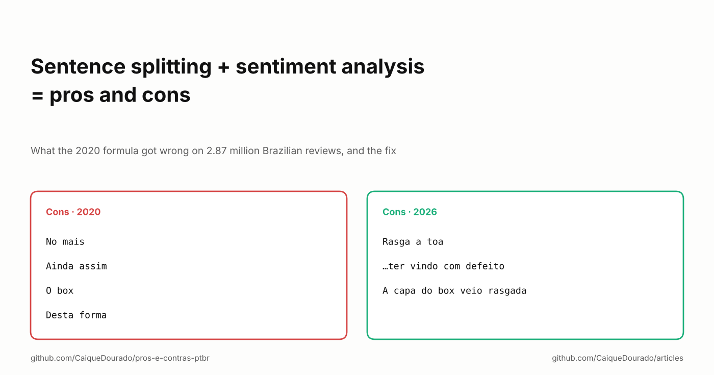
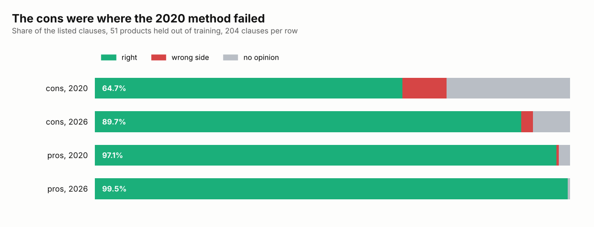

# Sentence splitting + sentiment analysis = pros and cons

*What the 2020 formula got wrong on 2.87 million Brazilian reviews, and the fix.*

[Leia em português](README.pt-BR.md) · [On Medium](https://medium.com/@caiquedourado/sentence-splitting-sentiment-analysis-pros-and-cons-e3907d8d1d96)



From 2020 on, the product pages of my sites showed "Prós" and "Contras" (pros and cons) taken from store reviews. My
presentation from back then summed up the method as a formula: **sentence splitting + sentiment analysis = pros and
cons**. Cut every review into clauses, find out which clauses are good and which are bad, and list the ones customers
repeat most.

The formula is right. Both halves of it were done wrong. The Samsung Expert X23 notebook, with 1,947 reviews, listed
*"A entrega foi bem rápida"* ("delivery was really fast") among its cons. This article is how each half failed and
what changed when I rebuilt the method in 2026 as an open library,
[pros-e-contras-ptbr](https://github.com/CaiqueDourado/pros-e-contras-ptbr). Each half has a longer write-up in the
library; this is the whole story in one place.

## Half 1: cutting reviews into clauses

"Bonito, mas trava muito e esquenta" ("Nice-looking, but it freezes a lot and heats up") holds three opinions. The rule
to cut it never changed: cut at punctuation and at coordinating conjunctions (*e, mas, ou, porém, pois…*), but not at
words that start an idea that cannot stand alone (*que, se, como, quando…*). What changed three times was **who decides
what is a conjunction**.

**Google Cloud Natural Language, until January 2020.** Its syntax analysis tagged each word, and the cut happened at
the `PUNCT` and `CONJ` tags. Quality was good, but it charges per text, and there were millions of reviews with more
arriving every day. A comment in the code reads: **"January 9, 2020. Stopped. Way too expensive!!!"**

**Stanford POS tagger, 2020.** Free, local, running inside .NET with a third-party Portuguese model. It cut the 12.9
million clauses later published in the [reviews dataset](https://github.com/CaiqueDourado/portuguese-product-reviews).
The price was the model's mistakes on colloquial text: it tagged *não Recomendo* as two proper nouns and *aguenta* as an
adjective, cut "é um produto **q** responde" at the abbreviation *q*, and did not cut at *porém* without its accent.
Every tagging error became a cutting error.

**Rules, no tagger, 2026.** The tagger was only there to recognise punctuation and conjunctions, and Portuguese
coordinating conjunctions are a short list. So the library has none:

```python
CUT = {"e", "mas", "ou", "porém", "porem", "contudo", "todavia", "entretanto", "pois"}
KEEP = {"que", "se", "como", "quando", "quanto", "enquanto", "apenas"}
```

On 15,100 reviews, against the 2020 Stanford clauses:

| | Rules | spaCy `pt_core_news_sm` |
|---|---:|---:|
| 2020 clauses also produced (recall) | 95.3% | 93.9% |
| Clauses that exist in 2020 (precision) | 94.9% | 94.9% |
| Reviews cut exactly the same | 88.1% | 86.3% |
| Speed | 22,000 reviews/s | 260 reviews/s |

A modern tagger does not get closer to the 2020 output than fifteen lines of rules, and it is 85 times slower. All
2.87 million reviews now split in about two minutes. One deliberate choice: the rules do not cut at *nem* ("nor"),
because in reviews it is almost always a negation (*nem liga*, "doesn't even turn on"), and cutting a negation from its
verb flips the opinion.

## Half 2: deciding what is a pro and what is a con

In 2020, AWS Comprehend gave each review a sentiment, the clauses were grouped by phonetic and fingerprint keys, and
the 4 most repeated clauses of the positive reviews became pros, those of the negative reviews became cons. Four flaws
hid in those steps:

1. **Sentiment belonged to the review, not the clause.** In a negative review, "delivery was really fast, but the
   product is slow" makes both clauses negative. That is how fast delivery became a con. Mixed reviews, the very ones
   with pros *and* cons, were not used at all.
2. **Any short piece counted.** The cut leaves connectives behind. The cons of a DVD box set were *No mais · Ainda
   assim · O box · Desta forma* ("Other than that · Even so · The box · That way").
3. **Grouping joined opposites.** One of the keys skipped every other word because of a bug ([the article on
   text similarity](../text-similarity/README.md) tells that one), so "terrible quality" and "great quality" could become one
   group.
4. **Ties favoured the generic.** Between two clauses with the same count, the one most frequent on the whole site won,
   the opposite of IDF. "Muito bom" almost always won.

The fix gives **each clause its own score**, from a lexicon learned from the reviews themselves, with no hand labelling.
A clause from a 4–5 star review is positive evidence, one from a 1–2 star review negative evidence, 3 stars left out.
Stars instead of the AWS label, because stars are the customer's own judgement. Each word's weight is the smoothed
log-odds between the two sides, as in Monroe, Colaresi and Quinn's "Fightin' Words" (2008). From 9.8 million positive
and 1.9 million negative clauses came a lexicon of 6,854 words.

Negation makes a new word: the three words after *não, nunca, nem* or *sem* count as `NOT_word`. The lexicon learned on
its own that *funciona* ("works") is weak praise (+0.32, left out) and *NOT_funciona* is a strong complaint (−3.35);
*recomendo* is +3.47 and *NOT_recomendo* −3.88.

Three smaller rules close the other flaws: a clause is listed only if its score reaches 1.5 on one side, so filler never
gets in; grouping is exact after removing accents, plurals and stopwords, keeping negations; and ranking counts distinct
reviews, with ties going to the stronger opinion.

## How much better

I held 51 products out of the lexicon training and labelled every listed clause, in the 2020 output as published and in
the library's, as *right*, *wrong side* or *no opinion*. Both start from the same 2020 clauses, so the difference is the
second half alone:



Pros were already fine: in a product people like, almost everything said is praise. The cons are where the 2020 method
failed, and where the fix shows: 64.7% right became 89.7%, and wrong-side cons fell from 9.3% to 2.5%. The DVD box set
went from *No mais · Ainda assim · O box · Desta forma* to *Rasga a toa · …ter vindo com defeito · A capa do box veio
rasgada* ("tears easily · …arrived defective · the box cover arrived torn").

## What still goes wrong

- **Sentences, not words.** A word lexicon misses meaning that lives in the sentence. "Ansiosa de descobrir o que virá
  em seguida" ("can't wait to find out what comes next") is praise, and its fragment still showed up as a con. Sarcasm
  and double negation get through too.
- **Thin products.** When a product has few repeated complaints, the slots fill with clauses said only once. With
  `min_mentions=2` the list gets shorter: 2 cons per product, 89.4% right.
- **One labeller.** Claude (Anthropic's model) wrote the evaluation labels. They are in the repository for anyone to
  check, but I have no agreement measure from a second annotator yet.

## Why a lexicon and not an LLM

An LLM would write better pros and cons for one product. For 222,000 products, a rule you can audit word by word, that
runs on an ordinary machine with no per-call cost, still makes sense: the same lesson Google Cloud NL taught in 2020. And
the question the pages answered is about counting, not writing: what do customers *repeat* about this product?

## What I would tell myself in 2020

- **Score the unit you show.** The pages showed clauses; the sentiment was per review. Every wrong-side con came from
  that gap.
- **Check whether you need the model at all.** The tagger only had to recognise a closed list of words.
- **Let your own data label itself.** Stars on 2.87 million reviews were a better training signal than a paid API.
- **Evaluate the side that fails.** Pros at 97% hid cons at 65%.

**Links**

- The library: [pros-e-contras-ptbr](https://github.com/CaiqueDourado/pros-e-contras-ptbr), with the detailed
  write-ups [on clause splitting](https://github.com/CaiqueDourado/pros-e-contras-ptbr/blob/main/docs/article-clause-splitting.md)
  and [on pros and cons](https://github.com/CaiqueDourado/pros-e-contras-ptbr/blob/main/docs/article-pros-and-cons.md)
- The data: [portuguese-product-reviews](https://github.com/CaiqueDourado/portuguese-product-reviews) ([Kaggle](https://www.kaggle.com/datasets/caiquedourado/reviews-produtos-ptbr))
- Previous article: [Finding the same photo across 7,179 stores](../image-similarity/README.md)
- More articles: [github.com/CaiqueDourado/articles](https://github.com/CaiqueDourado/articles)

*Caique Dourado has spent 20 years building crawlers, data pipelines and programmatic SEO in .NET and SQL Server.*
