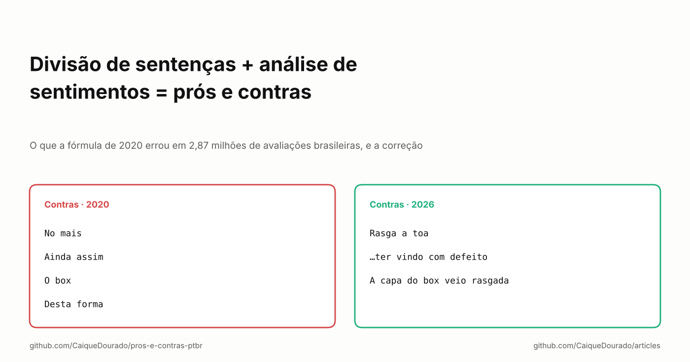
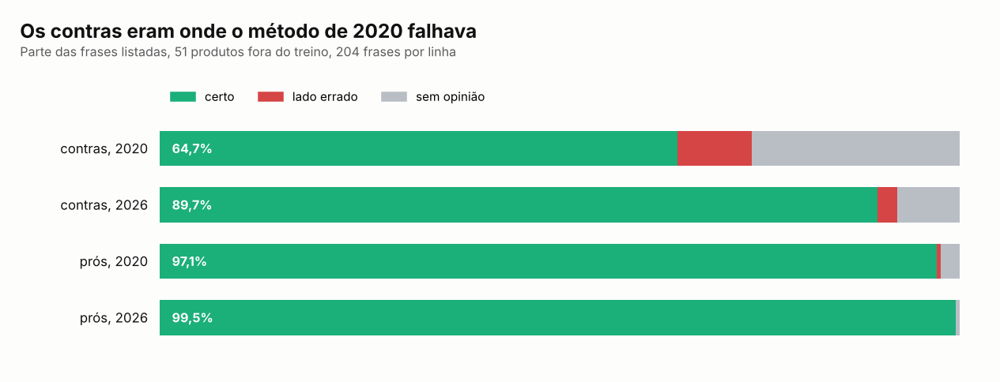

# Divisão de sentenças + análise de sentimentos = prós e contras

*O que a fórmula de 2020 errou em 2,87 milhões de avaliações brasileiras, e a correção.*

[Read in English](README.md)



A partir de 2020, as páginas de produto dos meus sites mostravam "Prós" e "Contras" tirados das avaliações das lojas.
A apresentação que fiz na época resumia o método numa conta: **divisão de sentenças + análise de sentimentos = prós e
contras**. Cortar cada avaliação em cláusulas, descobrir quais são boas e quais são ruins e listar as que os clientes
mais repetem.

A conta está certa. As duas metades foram mal feitas. O notebook Samsung Expert X23, com 1.947 avaliações, listava
*"A entrega foi bem rápida"* entre os contras. Este artigo é como cada metade falhou e o que mudou quando refiz o
método em 2026 como biblioteca aberta, a [pros-e-contras-ptbr](https://github.com/CaiqueDourado/pros-e-contras-ptbr).
Cada metade tem um texto mais longo na biblioteca; aqui está a história inteira num lugar só.

## Metade 1: cortar avaliações em cláusulas

"Bonito, mas trava muito e esquenta" tem três opiniões. A regra para cortar nunca mudou: cortar na pontuação e nas
conjunções coordenativas (*e, mas, ou, porém, pois…*), mas não nas palavras que abrem uma ideia que não fica de pé
sozinha (*que, se, como, quando…*). O que mudou três vezes foi **quem decide o que é conjunção**.

**Google Cloud Natural Language, até janeiro de 2020.** A análise sintática etiquetava cada palavra, e o corte era nas
etiquetas `PUNCT` e `CONJ`. A qualidade era boa, mas a cobrança é por texto, e eram milhões de avaliações, com mais
chegando todo dia. Um comentário no código diz: **"9 de janeiro de 2020. Parado. Caro demais!!!"**

**Stanford POS Tagger, 2020.** De graça, local, rodando dentro do .NET com um modelo de português de terceiros. Ele
cortou os 12,9 milhões de cláusulas publicadas depois na [base de avaliações](https://github.com/CaiqueDourado/portuguese-product-reviews).
O preço foram os erros do modelo em texto coloquial: etiquetava *não Recomendo* como dois nomes próprios e *aguenta*
como adjetivo, cortava "é um produto **q** responde" na abreviação *q* e não cortava em *porem* sem acento. Cada erro
de etiqueta virava um erro de corte.

**Regras, sem tagger, 2026.** O tagger só estava ali para reconhecer pontuação e conjunções, e as conjunções
coordenativas do português são uma lista curta. Então a biblioteca não tem tagger:

```python
CUT = {"e", "mas", "ou", "porém", "porem", "contudo", "todavia", "entretanto", "pois"}
KEEP = {"que", "se", "como", "quando", "quanto", "enquanto", "apenas"}
```

Em 15.100 avaliações, comparando com as cláusulas do Stanford de 2020:

| | Regras | spaCy `pt_core_news_sm` |
|---|---:|---:|
| Cláusulas de 2020 também geradas (revocação) | 95,3% | 93,9% |
| Cláusulas que existem em 2020 (precisão) | 94,9% | 94,9% |
| Avaliações cortadas exatamente igual | 88,1% | 86,3% |
| Velocidade | 22.000 avaliações/s | 260 avaliações/s |

Um tagger moderno não chega mais perto do resultado de 2020 do que quinze linhas de regras, e é 85 vezes mais lento.
As 2,87 milhões de avaliações agora são cortadas em uns dois minutos. Uma escolha de propósito: as regras não cortam
em *nem*, porque em avaliação ele quase sempre é negação (*nem liga*), e separar a negação do verbo inverte a opinião.

## Metade 2: decidir o que é pró e o que é contra

Em 2020, o AWS Comprehend dava um sentimento para cada avaliação, as cláusulas eram agrupadas por chaves fonéticas e de
fingerprint, e as 4 cláusulas mais repetidas das avaliações positivas viravam prós, as das negativas viravam contras.
Quatro defeitos estavam escondidos nesses passos:

1. **O sentimento era da avaliação, não da cláusula.** Numa avaliação negativa, "a entrega foi bem rápida, mas o
   produto é lento" deixa as duas cláusulas negativas. Foi assim que entrega rápida virou contra. As avaliações
   mistas, justamente as que têm prós *e* contras, não eram usadas.
2. **Qualquer pedaço curto contava.** O corte deixa sobrar conectivos. Os contras de um box de DVDs eram *No mais ·
   Ainda assim · O box · Desta forma*.
3. **O agrupamento juntava opostos.** Uma das chaves pulava uma palavra sim, outra não, por um bug ([o artigo sobre
   similaridade de texto](../text-similarity/README.pt-BR.md) conta esse), então "péssima qualidade" e "ótima
   qualidade" podiam virar um grupo só.
4. **O desempate premiava o genérico.** Entre duas cláusulas com a mesma contagem, ganhava a mais frequente no site
   inteiro, o contrário do IDF. "Muito bom" vencia quase sempre.

A correção dá **uma nota para cada cláusula**, de um léxico aprendido nas próprias avaliações, sem anotação manual.
Uma cláusula de avaliação de 4 ou 5 estrelas é evidência positiva, uma de 1 ou 2 estrelas é negativa, as de 3 ficam de
fora. Estrelas em vez do rótulo da AWS, porque as estrelas são o julgamento do próprio cliente. O peso de cada palavra
é o log-odds suavizado entre os dois lados, como no "Fightin' Words" de Monroe, Colaresi e Quinn (2008). De 9,8 milhões
de cláusulas positivas e 1,9 milhão negativas saiu um léxico de 6.854 palavras.

A negação vira outra palavra: as três palavras depois de *não, nunca, nem* ou *sem* contam como `NOT_palavra`. O léxico
aprendeu sozinho que *funciona* é um elogio fraco (+0,32, fica fora) e *NOT_funciona* é uma reclamação forte (−3,35);
*recomendo* vale +3,47 e *NOT_recomendo*, −3,88.

Três regras menores fecham os outros defeitos: uma cláusula só entra na lista com nota de pelo menos 1,5 para um dos
lados, então enchimento não entra; o agrupamento é exato depois de tirar acentos, plurais e stopwords, mantendo as
negações; e a ordem conta avaliações distintas, com desempate pela opinião mais forte.

## Quanto melhorou

Deixei 51 produtos fora do treino do léxico e rotulei cada cláusula listada, no resultado de 2020 como foi publicado e
no da biblioteca, como *certa*, *lado errado* ou *sem opinião*. Os dois partem das mesmas cláusulas de 2020, então a
diferença é só da segunda metade:



Os prós já iam bem: num produto de que as pessoas gostam, quase tudo o que se diz é elogio. Os contras são onde o
método de 2020 falhava, e onde a correção aparece: 64,7% certos viraram 89,7%, e os contras do lado errado caíram de
9,3% para 2,5%. O box de DVDs passou de *No mais · Ainda assim · O box · Desta forma* para *Rasga a toa · …ter vindo
com defeito · A capa do box veio rasgada*.

## O que ainda dá errado

- **Frases, não palavras.** Um léxico de palavras perde o sentido que está na frase. "Ansiosa de descobrir o que virá
  em seguida" é elogio, e um pedaço dela ainda apareceu como contra. Sarcasmo e dupla negação também passam.
- **Produtos com pouca reclamação.** Quando um produto tem poucas reclamações repetidas, as vagas são preenchidas por
  cláusulas ditas uma vez só. Com `min_mentions=2` a lista fica menor: 2 contras por produto, 89,4% certos.
- **Um só rotulador.** O Claude (modelo da Anthropic) escreveu os rótulos da avaliação. Eles estão no repositório para
  qualquer um conferir, mas ainda não tenho a concordância com um segundo anotador.

## Por que um léxico e não um LLM

Um LLM escreveria prós e contras melhores para um produto. Para 222.000 produtos, uma regra que dá para auditar palavra
por palavra, que roda numa máquina comum sem custo por chamada, ainda faz sentido: a mesma lição que o Google Cloud NL
deu em 2020. E a pergunta que as páginas respondiam é de contagem, não de redação: o que os clientes *repetem* sobre
este produto?

## O que eu diria para mim mesmo em 2020

- **Dê nota à unidade que você mostra.** As páginas mostravam cláusulas; o sentimento era por avaliação. Todo contra do
  lado errado veio dessa diferença.
- **Confira se você precisa do modelo.** O tagger só tinha que reconhecer uma lista fechada de palavras.
- **Deixe seus dados se rotularem.** As estrelas de 2,87 milhões de avaliações foram um sinal de treino melhor do que
  uma API paga.
- **Avalie o lado que falha.** Prós com 97% escondiam contras com 65%.

**Links**

- A biblioteca: [pros-e-contras-ptbr](https://github.com/CaiqueDourado/pros-e-contras-ptbr), com os textos detalhados
  [sobre a divisão de cláusulas](https://github.com/CaiqueDourado/pros-e-contras-ptbr/blob/main/docs/artigo-divisao-de-clausulas.md)
  e [sobre prós e contras](https://github.com/CaiqueDourado/pros-e-contras-ptbr/blob/main/docs/artigo-pros-e-contras.md)
- Os dados: [portuguese-product-reviews](https://github.com/CaiqueDourado/portuguese-product-reviews) ([Kaggle](https://www.kaggle.com/datasets/caiquedourado/reviews-produtos-ptbr))
- Artigo anterior: [Achando a mesma foto em 7.179 lojas](../image-similarity/README.pt-BR.md)
- Mais artigos: [github.com/CaiqueDourado/articles](https://github.com/CaiqueDourado/articles)

*Caique Dourado constrói há 20 anos crawlers, pipelines de dados e SEO programático em .NET e SQL Server.*
