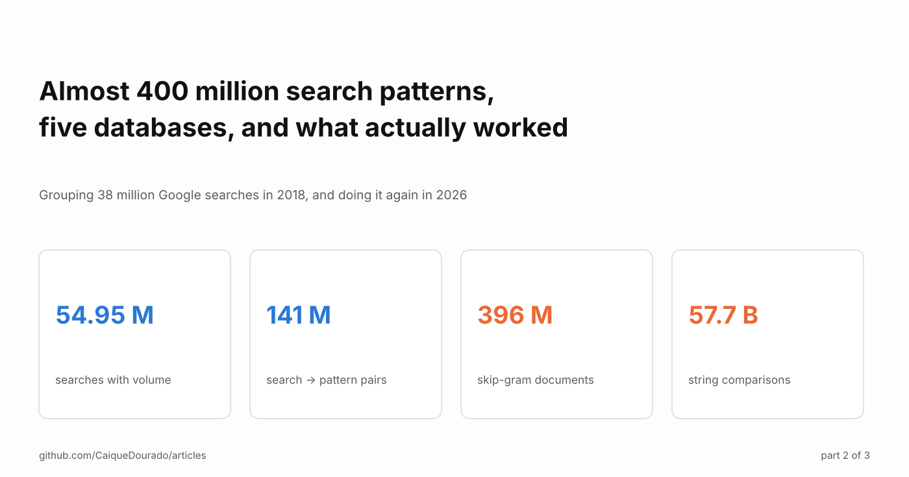
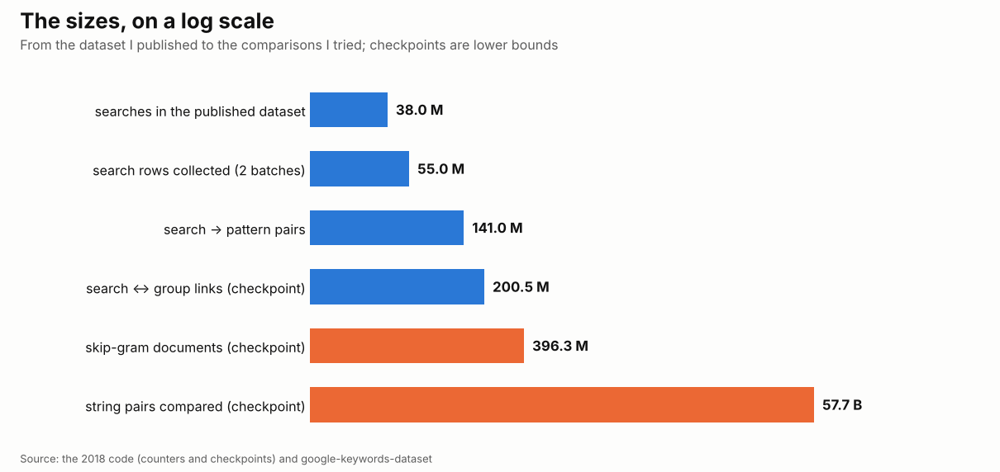
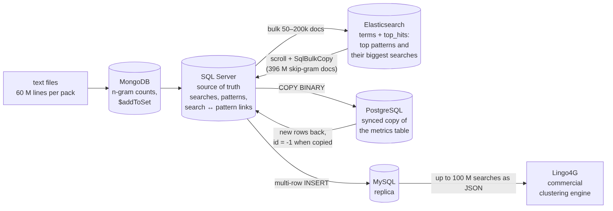
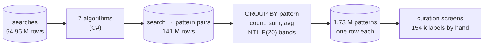

# Almost 400 million search patterns, five databases, and what actually worked

*Grouping 38 million Google searches in 2018, and doing it again in 2026. Part 2 of 3.*

[Leia em português](README.pt-BR.md) · [On Medium](https://medium.com/@caiquedourado/almost-400-million-search-patterns-five-databases-and-what-actually-worked-139cb4a28c4e) · Part 1: [Seven ways to turn millions of Google searches into page templates](https://medium.com/@caiquedourado/seven-ways-to-turn-millions-of-google-searches-into-page-templates-3671235eac0f)

[Part 1](https://medium.com/@caiquedourado/seven-ways-to-turn-millions-of-google-searches-into-page-templates-3671235eac0f)
explained seven algorithms that turn Google searches into page templates: *como fazer panqueca* and *como fazer pudim*
become `com faz [comida]`. This part is about what happened when I ran them over tens of millions of searches, between
August and October 2018, with one SQL Server, a desktop and no budget for a cluster. I tried five databases and a
commercial clustering engine. Most of it did not survive. What did is simpler than any of it.

## How the numbers grow

An algorithm does not produce one pattern per search. *Fogão industrial dako 5 bocas* gives 4 prefixes, 6 runs of
words, 16 skip-grams and 15 bags of words: **41 patterns from one search**, before entities. Multiply by tens of millions
of searches and every table becomes the biggest table you have ever had.

The searches came in two batches from keyword tools, 54.95 million rows with volume, CPC and competition (37.96 million
after removing duplicates, the version I published). The pairs *search → pattern* reached 141 million rows. One table of
links between searches and groups passed 200 million. The skip-gram index in Elasticsearch passed 396 million documents.
And one experiment, comparing strings two by two, has a checkpoint in the code at **57,708,899,736 pairs**.

## Five databases

Each database came in to solve one problem the previous one had:

- **SQL Server** was the source of truth from start to finish: the searches, the patterns and the links between them,
  each in its own database.
- **Elasticsearch** was for exploring. One `terms` aggregation with `top_hits` inside answers in seconds the question I
  asked a hundred times a day: *the 50 most common three-word patterns, and the 5 biggest searches of each.*
- **MongoDB** was for counting. The words of the searches were split into packs of 60 million lines and counted with
  upserts and `$addToSet`, which keeps, for every n-gram, the list of searches that contain it.
- **PostgreSQL** held a synced copy of the metrics table; new rows arrived there first, and rows copied back to SQL
  Server were marked with `id = -1`.
- **MySQL** was a replica made for one thing: exporting up to 100 million searches as JSON to **Lingo4G**, a commercial
  clustering engine (Carrot Search), to see whether a ready-made tool would find the templates for me.

And beside them, one brute-force experiment: comparing every entity of the dictionary with every word of the searches by
string similarity (Jaro-Winkler, Levenshtein, Dice), to find spelling variants. That is where the 57.7 billion pairs come
from.

## What broke

Reading this code again in 2026, every move between databases had its own bug. They are worth listing, because they are
the bugs anyone writes at this scale:

- **A resume that never resumed.** The Elasticsearch → SQL Server migration was meant to skip the first 396,320,000
  documents already copied. The check `if (count < last) continue;` ran *before* `count++`, so the count never moved and
  **every document was skipped**: the job walked the whole index and wrote nothing. The newer version of the 57-billion comparison page had
  the same bug, with a checkpoint of 35.6 billion: it compared nothing. *Resume by key (`id > last_id`),
  never by a counter, and count the rows on both sides after every move.*
- **The fast path, used slowly.** PostgreSQL's binary `COPY` was opened once per row, which is slower than plain inserts,
  and never completed, which newer drivers treat as a cancel.
- **Batches at the edge of the limit.** 200,000 documents per bulk request to Elasticsearch is close to its default
  100 MB request limit when searches are long.
- **Clocks that lied.** Timings printed `Elapsed.Milliseconds`, the milliseconds *component* (0–999), not the total. Every
  timing those pages printed was wrong.
- **Two tables, one id space.** Rows from different tables went into the same index; only a sequential id added later kept
  them from overwriting each other silently.

None of this crashed. That is the problem: at this scale a bug does not fail, it quietly does nothing for hours.

## What actually worked

The version that produced the data I used, and later published, has no cluster and no clustering engine:

1. **SQL Server only.** One table of searches, one table of *search → pattern* pairs, written by the C# algorithms.
2. **Keys computed once, stored as columns.** Stems, phonetic keys, fingerprints: computed when a row arrived, indexed,
   never recomputed in a query.
3. **`GROUP BY` and `NTILE(20)`.** One aggregation per algorithm: number of searches, total volume, average competition
   and CPC, the leading search, and the 1–20 bands that the curation screens painted as a heat map.
4. **A person at the end.** 154,654 patterns labelled by hand. No engine replaced that.

Elasticsearch was faster for exploring and Lingo4G was worth the test, but neither gave me what I needed: a stable table
where every search has a pattern, every pattern has numbers, and I can come back next week and get the same answer.

## Doing it again in 2026

When I opened this data again to publish it, the five databases became one file format and one engine. Each SQL Server
table was **exported once to Parquet**, and every step after that, cleaning, removing duplicates (54.95 million rows →
37.96 million), joining patterns to searches, checking the totals, runs in **DuckDB** on one machine, with the checks in
CI. The algorithms themselves became a library with no database at all
([search-pattern-miner](https://github.com/CaiqueDourado/search-pattern-miner)), and the result is a dataset anyone can
download ([google-keywords-dataset](https://github.com/CaiqueDourado/google-keywords-dataset)).

## What I would tell myself in 2018

- **Pick one store for the truth and copy out only for a question.** Every copy is a place for rows to go missing.
- **Resume by key, verify by count.** Every long job needs a checkpoint that cannot be skipped and a count that proves it
  ran.
- **Precompute the keys.** A stem or a fingerprint computed at insert time is an index; computed in a query, it is a full
  scan.
- **Generate less.** 41 patterns per search is mostly noise. Keep the algorithms that make templates (prefix, entity
  prefix, entity skip-gram) and cap or sample the rest.
- **Columnar files beat servers for analysis.** Parquet and an embedded engine do on one laptop what took five databases.

## Next in this series

[Part 3](https://medium.com/@caiquedourado/from-1-7-million-search-patterns-to-83-sites-how-i-chose-what-to-build-f764687dfe12) is the decision: how 1.73 million patterns and 154 thousand labels became about 80 sites, and which niches I
dropped.

**Links**

- Part 1: [Seven ways to turn millions of Google searches into page templates](https://medium.com/@caiquedourado/seven-ways-to-turn-millions-of-google-searches-into-page-templates-3671235eac0f)
- Searches, patterns and labels: [google-keywords-dataset](https://github.com/CaiqueDourado/google-keywords-dataset) ([Kaggle](https://www.kaggle.com/datasets/caiquedourado/google-keywords-dataset))
- The algorithms: [search-pattern-miner](https://github.com/CaiqueDourado/search-pattern-miner)

*Caique Dourado has spent 20 years building crawlers, data pipelines and programmatic SEO in .NET and SQL Server.*
