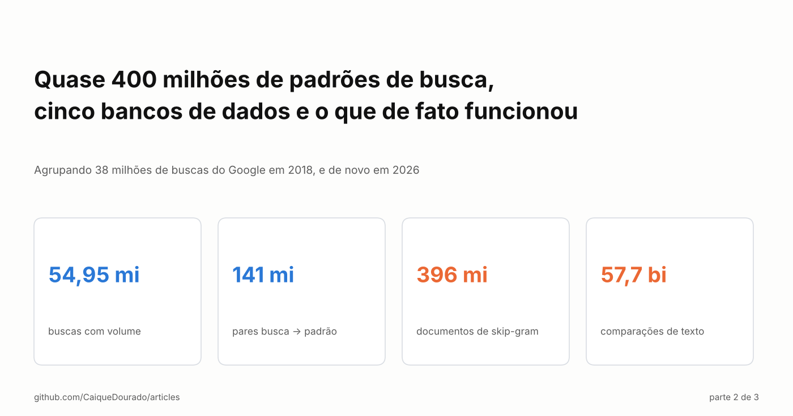
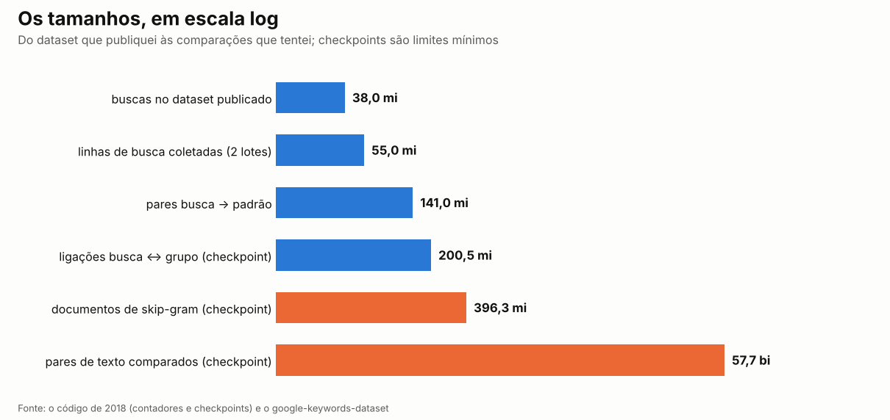
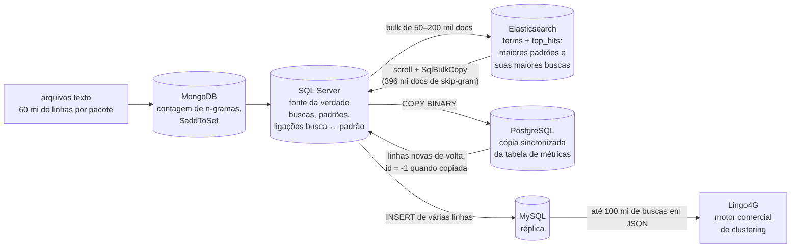
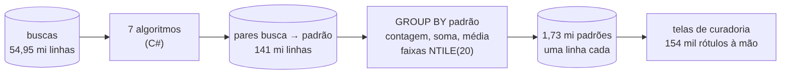

# Quase 400 milhões de padrões de busca, cinco bancos de dados e o que de fato funcionou

*Agrupando 38 milhões de buscas do Google em 2018, e de novo em 2026. Parte 2 de 3.*

[Read in English](README.md) · Parte 1: [Sete jeitos de transformar milhões de buscas do Google em modelos de página](../seven-ways-search-patterns/README.pt-BR.md)

A [parte 1](../seven-ways-search-patterns/README.pt-BR.md) explicou sete algoritmos que transformam buscas do Google em
modelos de página: *como fazer panqueca* e *como fazer pudim* viram `com faz [comida]`. Esta parte é sobre o que
aconteceu quando rodei esses algoritmos sobre dezenas de milhões de buscas, entre agosto e outubro de 2018, com um SQL
Server, um desktop e nenhum orçamento para cluster. Testei cinco bancos de dados e um motor comercial de clustering. A
maior parte não sobreviveu. O que sobreviveu é mais simples que qualquer um deles.

## Como os números crescem

Um algoritmo não produz um padrão por busca. *Fogão industrial dako 5 bocas* dá 4 prefixos, 6 sequências, 16
skip-grams e 15 sacos de palavras: **41 padrões de uma busca só**, antes das entidades. Multiplique por dezenas de
milhões de buscas e toda tabela vira a maior tabela que você já teve.

As buscas vieram em dois lotes de ferramentas de palavras-chave, 54,95 milhões de linhas com volume, CPC e
concorrência (37,96 milhões depois de tirar as duplicadas, a versão que publiquei). Os pares *busca → padrão* chegaram
a 141 milhões de linhas. Uma tabela de ligações entre buscas e grupos passou de 200 milhões. O índice de skip-grams no
Elasticsearch passou de 396 milhões de documentos. E um experimento, comparando textos dois a dois, tem no código um
checkpoint em **57.708.899.736 pares**.

## Cinco bancos de dados

Cada banco entrou para resolver um problema que o anterior tinha:

- **SQL Server** foi a fonte da verdade do começo ao fim: as buscas, os padrões e as ligações entre eles, cada um no
  seu banco.
- **Elasticsearch** era para explorar. Uma agregação `terms` com `top_hits` dentro responde em segundos a pergunta que
  eu fazia cem vezes por dia: *os 50 padrões de três palavras mais comuns, e as 5 maiores buscas de cada um.*
- **MongoDB** era para contar. As palavras das buscas eram divididas em pacotes de 60 milhões de linhas e contadas com
  upserts e `$addToSet`, que guarda, para cada n-grama, a lista das buscas que o contêm.
- **PostgreSQL** tinha uma cópia sincronizada da tabela de métricas; linhas novas chegavam primeiro lá, e as copiadas de
  volta para o SQL Server eram marcadas com `id = -1`.
- **MySQL** era uma réplica feita para uma coisa só: exportar até 100 milhões de buscas em JSON para o **Lingo4G**, um
  motor comercial de clustering (Carrot Search), para ver se uma ferramenta pronta acharia os modelos por mim.

E ao lado deles, um experimento de força bruta: comparar cada entidade do dicionário com cada palavra das buscas por
semelhança de texto (Jaro-Winkler, Levenshtein, Dice), para achar variações de grafia. É daí que vêm os 57,7 bilhões
de pares.

## O que quebrou

Relendo esse código em 2026, cada passagem entre bancos tinha o seu bug. Vale listar, porque são os bugs que qualquer
um escreve nessa escala:

- **Uma retomada que nunca retomava.** A migração Elasticsearch → SQL Server devia pular os primeiros 396.320.000
  documentos já copiados. O teste `if (count < last) continue;` rodava *antes* do `count++`, então a contagem nunca
  andava e **todo documento era pulado**: o job percorria o índice inteiro e não gravava nada. A versão nova da página
  dos 57 bilhões de comparações tinha o mesmo bug, com um checkpoint de 35,6 bilhões: não comparava nada. *Retome pela
  chave (`id > ultimo_id`), nunca por um contador, e conte as linhas dos dois lados depois de cada migração.*
- **O caminho rápido, usado devagar.** O `COPY` binário do PostgreSQL era aberto uma vez por linha, o que é mais lento
  que inserts comuns, e nunca era concluído, o que drivers mais novos tratam como cancelamento.
- **Lotes no limite.** 200.000 documentos por requisição bulk ao Elasticsearch ficam perto do limite padrão de 100 MB
  quando as buscas são longas.
- **Relógios que mentiam.** Os tempos imprimiam `Elapsed.Milliseconds`, a *parte* de milissegundos (0–999), não o
  total. Todo tempo que aquelas páginas mostravam estava errado.
- **Duas tabelas, um espaço de ids.** Linhas de tabelas diferentes iam para o mesmo índice; só um id sequencial criado
  depois impediu que uma sobrescrevesse a outra em silêncio.

Nada disso dava erro. Esse é o problema: nessa escala um bug não falha, ele passa horas sem fazer nada, em silêncio.

## O que de fato funcionou

A versão que produziu os dados que usei, e depois publiquei, não tem cluster nem motor de clustering:

1. **Só SQL Server.** Uma tabela de buscas, uma tabela de pares *busca → padrão*, gravada pelos algoritmos em C#.
2. **Chaves calculadas uma vez, guardadas como colunas.** Radicais, chaves fonéticas, fingerprints: calculados quando a
   linha chegava, indexados, nunca recalculados numa consulta.
3. **`GROUP BY` e `NTILE(20)`.** Uma agregação por algoritmo: número de buscas, volume total, concorrência e CPC médios,
   a busca líder e as faixas de 1 a 20 que as telas de curadoria pintavam como mapa de calor.
4. **Uma pessoa no fim.** 154.654 padrões rotulados à mão. Nenhum motor substituiu isso.

O Elasticsearch era mais rápido para explorar e o Lingo4G valeu o teste, mas nenhum me deu o que eu precisava: uma
tabela estável em que toda busca tem um padrão, todo padrão tem números, e eu volto na semana seguinte e recebo a
mesma resposta.

## Fazendo de novo em 2026

Quando reabri esses dados para publicar, os cinco bancos viraram um formato de arquivo e um motor. Cada tabela do SQL
Server foi **exportada uma vez para Parquet**, e todo passo depois disso, limpar, tirar duplicadas (54,95 milhões de
linhas → 37,96 milhões), juntar padrões e buscas, conferir os totais, roda no **DuckDB** numa máquina só, com as
conferências no CI. Os próprios algoritmos viraram uma biblioteca sem banco nenhum
([search-pattern-miner](https://github.com/CaiqueDourado/search-pattern-miner)), e o resultado é um dataset que
qualquer um pode baixar ([google-keywords-dataset](https://github.com/CaiqueDourado/google-keywords-dataset)).

## O que eu diria para mim mesmo em 2018

- **Escolha um lugar para a verdade e copie só para responder uma pergunta.** Cada cópia é um lugar para linhas
  sumirem.
- **Retome pela chave, confira pela contagem.** Todo job longo precisa de um checkpoint que não dá para pular e de uma
  contagem que prove que ele rodou.
- **Calcule as chaves antes.** Um radical ou fingerprint calculado na inserção é um índice; calculado na consulta, é
  uma varredura completa.
- **Gere menos.** 41 padrões por busca é quase tudo ruído. Fique com os algoritmos que fazem modelos (prefixo, prefixo
  com entidade, skip-gram com entidade) e limite ou amostre o resto.
- **Arquivos colunares batem servidores para análise.** Parquet e um motor embutido fazem num notebook o que levou
  cinco bancos.

## Próxima da série

A parte 3 é a decisão: como 1,73 milhão de padrões e 154 mil rótulos viraram cerca de 80 sites, e quais nichos eu
deixei de lado.

**Links**

- Parte 1: [Sete jeitos de transformar milhões de buscas do Google em modelos de página](../seven-ways-search-patterns/README.pt-BR.md) ([em inglês no Medium](https://medium.com/@caiquedourado/seven-ways-to-turn-millions-of-google-searches-into-page-templates-3671235eac0f))
- Buscas, padrões e rótulos: [google-keywords-dataset](https://github.com/CaiqueDourado/google-keywords-dataset) ([Kaggle](https://www.kaggle.com/datasets/caiquedourado/google-keywords-dataset))
- Os algoritmos: [search-pattern-miner](https://github.com/CaiqueDourado/search-pattern-miner)

*Caique Dourado constrói há 20 anos crawlers, pipelines de dados e SEO programático em .NET e SQL Server.*
