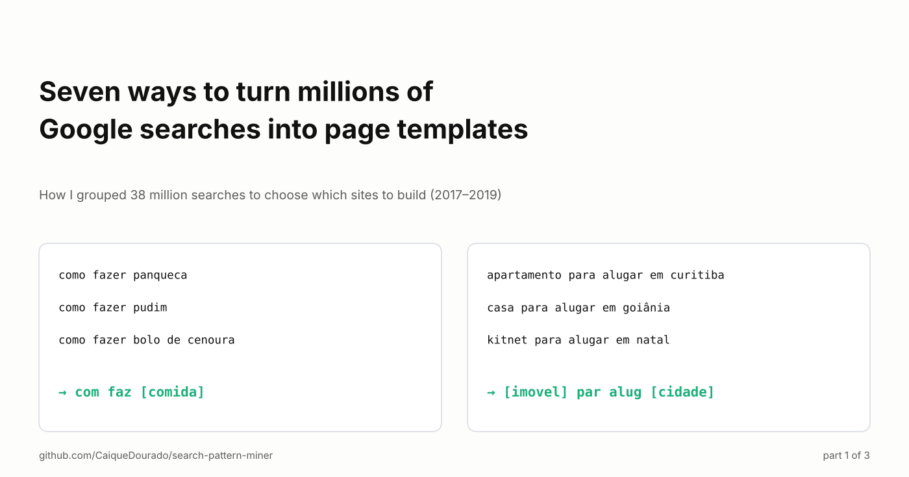
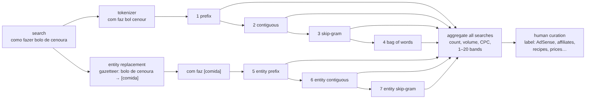
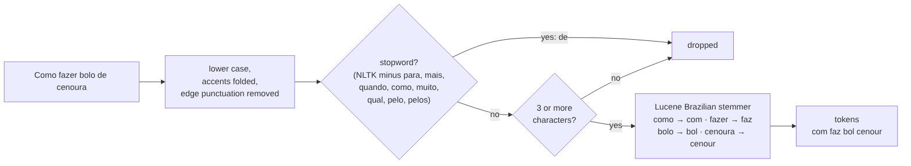
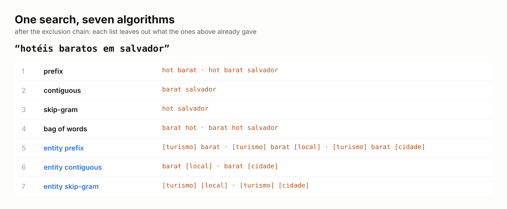
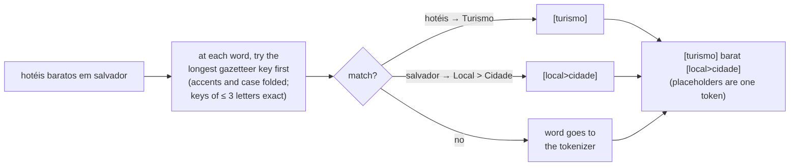
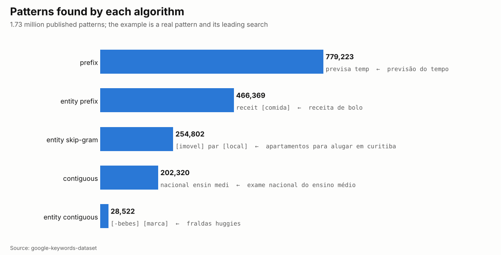
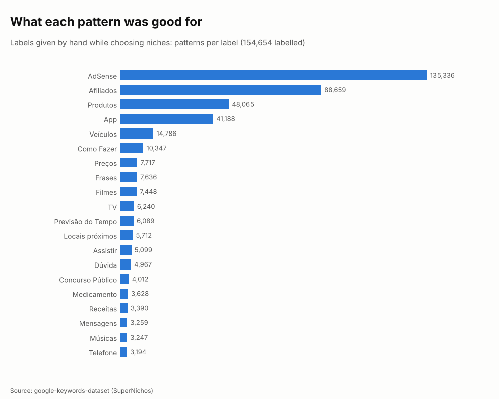

# Seven ways to turn millions of Google searches into page templates

*How I grouped 38 million searches to choose which sites to build (2017–2019). Part 1 of 3.*

[Leia em português](README.pt-BR.md) · [On Medium](https://medium.com/@caiquedourado/seven-ways-to-turn-millions-of-google-searches-into-page-templates-3671235eac0f)

In 2018 I had a table with millions of Google searches made in Brazil, each with its monthly volume, cost per click
and competition. I was building programmatic SEO sites, sites where one template becomes thousands of pages, and the
table held the answer to the only question that mattered: **which sites should I build next?**

Reading the searches one by one was hopeless. But a site is not a search, it is a *template*. *como fazer panqueca*,
*como fazer pudim* and *como fazer bolo de cenoura* are one page template with a slot for the food. *apartamento para
alugar em curitiba* and *casa para alugar em goiânia* are another, with two slots. If I could find the templates and
add up the volume of every search that fits each one, the table would rank the sites for me.

So I wrote algorithms that find what searches have in common. First one in T-SQL, then six more in C#, between
2017 and February 2019. They ended up running over 38 million searches, labelling 154 thousand of the patterns by hand
and choosing about 80 sites. In 2026 I rewrote them as an open-source library, in Python and .NET with identical
results: [search-pattern-miner](https://github.com/CaiqueDourado/search-pattern-miner). This article explains each one.

## The big picture

Every algorithm starts from the same tokenizer. Four of them work on the words; three first replace known entities
(foods, cities, property types…) with their type. Each one drops what the ones before it already produced for the same
search, so no pattern is counted twice. At the end, the patterns of all searches are added up and ranked.

## Step 0: the tokenizer

A pattern has to survive small differences in wording, so every word is cut to its stem with the Brazilian stemmer
of Lucene: *fazer*, *faz* and *fazendo* all become `faz`. Stopwords go away, except eight that carry meaning in a
search (*para, mais, quando, como, muito, qual, pelo, pelos*): `como fazer` must stay `com faz`, or every recipe would
look like every tutorial.

The price is readability. `previsa temp` is *previsão do tempo*, `com faz [comida]` is *como fazer + a food*. Patterns
group well and read badly, so people should always see the leading search, not the pattern.

## One search, seven algorithms

**1. Prefix: the first 2 to 5 words.** What the search *starts with*. In Portuguese the intent usually comes first
(*como fazer*, *previsão do tempo*, *resultado da*), so this was the most productive one: 779 thousand of the published
patterns, led by `previsa temp`, 90 thousand searches and 51 million searches a month. It became the main table of
SuperNichos.

**2. Contiguous: every run of words, anywhere.** Finds the core of searches that start differently: *exame nacional do
ensino médio*, *inscrição exame nacional do ensino médio* and *nota exame nacional do ensino médio* share `nacional ensin
medi`.

**3. Skip-gram: 2 to 4 words in their order, with gaps.** Joins searches with extra words in the middle: *como fazer
bolo **fofo** de cenoura* and *como fazer bolo **simples** de cenoura* share `com faz bol cenour`.

**4. Bag of words: the same combinations, order thrown away.** Words sorted alphabetically, so *cenoura bolo como
fazer* and *como fazer bolo de cenoura* share `bol cenour com faz`. It was the first one I wrote, in T-SQL. It is also
the noisiest: a five-word search gives fifteen bags, most of them meaningless.

## Entities: where the money was

Word patterns find *previsão do tempo*. They do not find that *hotéis baratos em salvador* and *pousada barata em
porto seguro* are the same site. For that, the search first goes through a dictionary of entities: at each word, the
longest known key wins and becomes its type in brackets. *salvador* is both a place and a city, so it becomes
`[local>cidade]`, and every pattern is made once per type.

**5. Entity prefix**, **6. entity contiguous** and **7. entity skip-gram** are the first three algorithms again, on
the replaced search. The last one was written in February 2019 for exactly this search: *hotéis baratos em salvador* →
`[turismo] [local]`, every cheap-hotel search in every city in one pattern.

These are the patterns that pay. `com faz [comida]` groups 98 thousand searches and 12 million searches a month;
`result [loterias]` (*resultado da quina*) 19 thousand and 16 million; `consult [documento]` (*consulta cnpj*) 6
thousand and 13 million. Of the 1.73 million published patterns, 750 thousand carry at least one entity.

The dictionary had about 316 thousand entities, from Wikipedia and DBpedia titles, product names from online stores
and lists I typed, curated by hand in a small internal tool. A cleaned version is now public:
[portuguese-entity-gazetteer](https://github.com/CaiqueDourado/portuguese-entity-gazetteer), 307 thousand entities
with 747 types.

## Ranking: bands and a human

A pattern alone means nothing; its searches do. For each pattern I added up the number of searches, the total volume,
the average competition and CPC, and kept the leading search. Then each measure was cut into 20 bands (SQL's
`NTILE(20)`): band 1 is the top 5% by volume, by number of searches, the lowest competition, the lowest CPC. On screen
it looked like a heat map, and a good niche was a row of low bands.

Then came the part no algorithm did: I read the patterns and labelled them by how they could make money and what kind
of page they needed.

154,654 patterns got labels. AdSense (135 thousand) and affiliate links (89 thousand) dominate; the rest is the type of
site: products, apps, vehicles, how-to, prices, films, weather, places nearby, public exams. Those labels chose the
sites. The searches, patterns and labels are published as the
[google-keywords-dataset](https://github.com/CaiqueDourado/google-keywords-dataset)
([Kaggle](https://www.kaggle.com/datasets/caiquedourado/google-keywords-dataset)).

## What rewriting it in 2026 showed

The library has two modes. The default fixes what the 2019 code got wrong; `legacy2019` keeps every bug on purpose, so
it gives back the published patterns: 921 of 921 Brazilian prefix rows, 400 of 400 sampled rows of the prefix and
contiguous algorithms, and, with the original entity dictionary, 400 of 400 for entity prefix and entity skip-gram.
The bugs were instructive:

- **Entities were replaced as strings, not words.** `pr` (Paraná) matched inside *previsão*. The fix: whole words,
  longest key first, and short keys (*pe*, *pr*, *pará*) only with their exact accents, so *pará* is a state and
  *para* is not.
- **The output lists kept duplicates**, the same pattern listed twice for one search.
- **A dropped word left a double space**, so some patterns differed from others only by an invisible space.

Python and .NET are checked against the same 8,801 values, so the two can never drift apart.

## What I would add today

The seven are purely about words and a dictionary. Looking at them again, there are techniques I missed, and I keep
them as the next algorithms of the library:

- **Suffix**, the mirror of the prefix: in Portuguese the modifier usually comes last (*… perto de mim*, *… preço*,
  *… para alugar*).
- **Significant phrases** (collocations by PMI): *ar condicionado* is one unit; today `ar` disappears (two letters)
  and `condicion` is combined with everything.
- **Phonetic keys** instead of stems, for typos: *xuveiro* and *chuveiro*.
- **Head and modifier**: *hotel barato em salvador* → `[turismo] {preço} {lugar}`, the structure of a site: one page per
  head, one per modifier.
- **Intent** (informational, commercial, transactional, navigational) as the first word of the pattern.
- And numbers with units kept as attributes: today *fogão 5 bocas* loses the 5, and four and six burners look the same.

## Next in this series

[Part 2](https://medium.com/@caiquedourado/almost-400-million-search-patterns-five-databases-and-what-actually-worked-139cb4a28c4e) is about scale: the same idea run over hundreds of millions of patterns and billions of comparisons,
through five databases. Part 3 is the decision: how these patterns became about 80 sites, and which niches I dropped.

**Links**

- Library: [search-pattern-miner](https://github.com/CaiqueDourado/search-pattern-miner) (Python and .NET, MIT)
- Searches, patterns and labels: [google-keywords-dataset](https://github.com/CaiqueDourado/google-keywords-dataset)
- Entities: [portuguese-entity-gazetteer](https://github.com/CaiqueDourado/portuguese-entity-gazetteer)

*Caique Dourado has spent 20 years building crawlers, data pipelines and programmatic SEO in .NET and SQL Server.*
