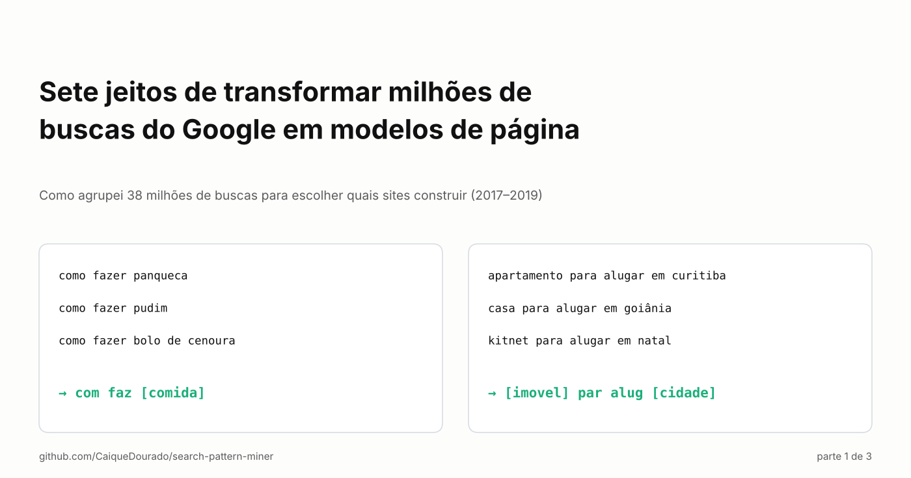
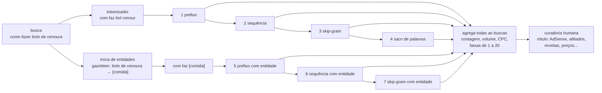
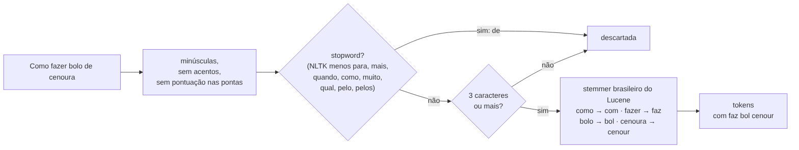
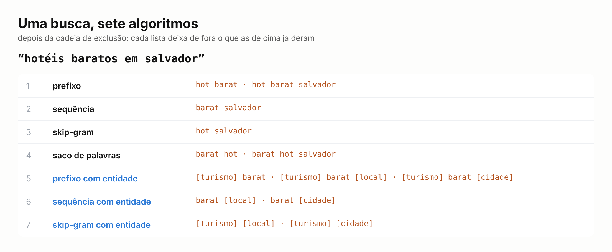
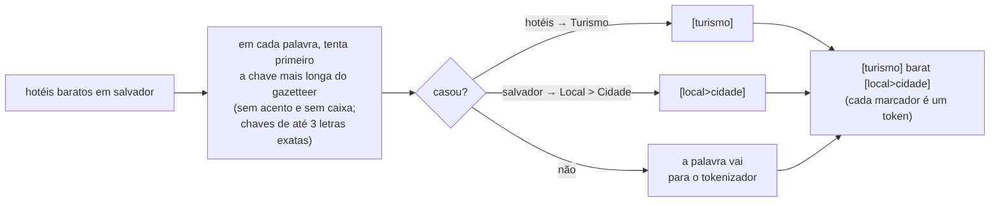
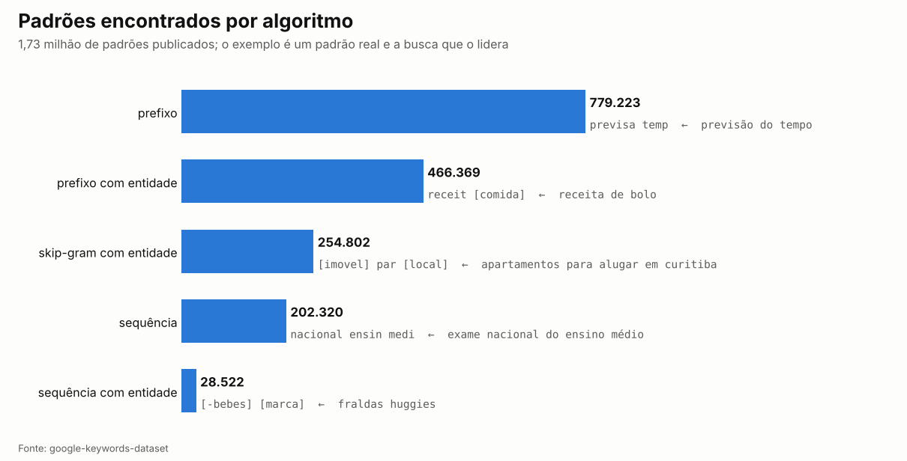
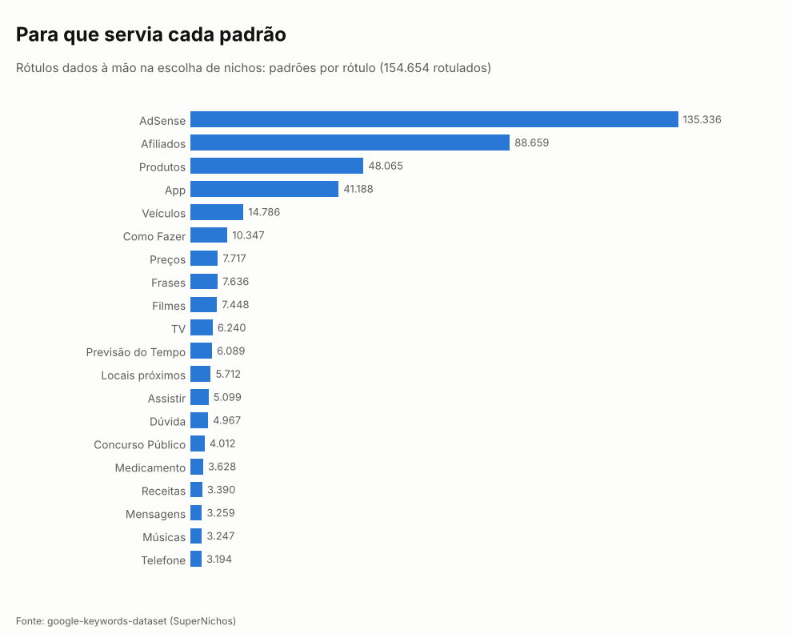

# Sete jeitos de transformar milhões de buscas do Google em modelos de página

*Como agrupei 38 milhões de buscas para escolher quais sites construir (2017–2019). Parte 1 de 3.*

[Read in English](README.md)

Em 2018 eu tinha uma tabela com milhões de buscas feitas no Google no Brasil, cada uma com o volume mensal, o custo
por clique e a concorrência. Eu construía sites de SEO programático, aqueles em que um modelo vira milhares de
páginas, e a tabela tinha a resposta para a única pergunta que importava: **qual site construir em seguida?**

Ler as buscas uma a uma era impossível. Mas um site não é uma busca, é um *modelo*. *como fazer panqueca*, *como
fazer pudim* e *como fazer bolo de cenoura* são um modelo de página com uma vaga para a comida. *apartamento para
alugar em curitiba* e *casa para alugar em goiânia* são outro, com duas vagas. Se eu achasse os modelos e somasse o
volume de todas as buscas que cabem em cada um, a tabela ordenaria os sites para mim.

Então escrevi algoritmos que acham o que as buscas têm em comum. O primeiro em T-SQL, depois mais seis em C#, entre
2017 e fevereiro de 2019. Eles acabaram rodando sobre 38 milhões de buscas, 154 mil dos padrões foram rotulados à mão,
e deles saíram cerca de 80 sites. Em 2026 reescrevi tudo como biblioteca aberta, em Python e .NET com resultados
idênticos: [search-pattern-miner](https://github.com/CaiqueDourado/search-pattern-miner). Este artigo explica cada um.

## A visão geral

Todos começam pelo mesmo tokenizador. Quatro trabalham sobre as palavras; três primeiro trocam entidades conhecidas
(comidas, cidades, tipos de imóvel…) pelo seu tipo. Cada um descarta o que os anteriores já produziram para a mesma
busca, então nenhum padrão é contado duas vezes. No fim, os padrões de todas as buscas são somados e ordenados.

## Passo 0: o tokenizador

Um padrão precisa resistir a pequenas diferenças de escrita, então cada palavra é reduzida ao radical pelo stemmer
brasileiro do Lucene: *fazer*, *faz* e *fazendo* viram `faz`. As stopwords saem, menos oito que têm sentido numa
busca (*para, mais, quando, como, muito, qual, pelo, pelos*): `como fazer` precisa continuar `com faz`, senão toda
receita ficaria igual a todo tutorial.

O preço é a leitura. `previsa temp` é *previsão do tempo*, `com faz [comida]` é *como fazer + uma comida*. Os padrões
agrupam bem e leem mal, então para pessoas sempre se mostra a busca líder, não o padrão.

## Uma busca, sete algoritmos

**1. Prefixo: as 2 a 5 primeiras palavras.** Como a busca *começa*. Em português a intenção costuma vir primeiro
(*como fazer*, *previsão do tempo*, *resultado da*), e por isso este foi o mais produtivo: 779 mil dos padrões
publicados, liderados por `previsa temp`, com 90 mil buscas e 51 milhões de buscas por mês. Virou a tabela principal
do SuperNichos.

**2. Sequência: toda sequência de palavras, em qualquer lugar.** Acha o miolo de buscas que começam diferente: *exame
nacional do ensino médio*, *inscrição exame nacional do ensino médio* e *nota exame nacional do ensino médio* dividem
`nacional ensin medi`.

**3. Skip-gram: de 2 a 4 palavras na ordem, com saltos.** Junta buscas com palavras a mais no meio: *como fazer bolo
**fofo** de cenoura* e *como fazer bolo **simples** de cenoura* dividem `com faz bol cenour`.

**4. Saco de palavras: as mesmas combinações, sem a ordem.** As palavras em ordem alfabética, então *cenoura bolo como
fazer* e *como fazer bolo de cenoura* dividem `bol cenour com faz`. Foi o primeiro que escrevi, em T-SQL. É também o
mais ruidoso: uma busca de cinco palavras dá quinze sacos, a maioria sem sentido.

## Entidades: onde estava o dinheiro

Padrões de palavras acham *previsão do tempo*. Não acham que *hotéis baratos em salvador* e *pousada barata em porto
seguro* são o mesmo site. Para isso, a busca passa antes por um dicionário de entidades: em cada palavra, a chave
conhecida mais longa vence e vira o seu tipo entre colchetes. *salvador* é lugar e cidade, então vira
`[local>cidade]`, e cada padrão é feito uma vez por tipo.

**5. Prefixo com entidade**, **6. sequência com entidade** e **7. skip-gram com entidade** são os três primeiros de
novo, sobre a busca trocada. O último foi escrito em fevereiro de 2019 exatamente para esta busca: *hotéis baratos em
salvador* → `[turismo] [local]`, toda busca de hotel barato em toda cidade num padrão só.

São os padrões que pagam. `com faz [comida]` agrupa 98 mil buscas e 12 milhões de buscas por mês; `result [loterias]`
(*resultado da quina*), 19 mil e 16 milhões; `consult [documento]` (*consulta cnpj*), 6 mil e 13 milhões. Dos 1,73
milhão de padrões publicados, 750 mil têm pelo menos uma entidade.

O dicionário tinha cerca de 316 mil entidades, vindas de títulos da Wikipédia e da DBpedia, de nomes de produto de
lojas virtuais e de listas que eu digitei, revisadas à mão numa ferramenta interna simples. Uma versão limpa agora é
pública: [portuguese-entity-gazetteer](https://github.com/CaiqueDourado/portuguese-entity-gazetteer), 307 mil
entidades com 747 tipos.

## Ordenando: faixas e uma pessoa

Um padrão sozinho não diz nada; as buscas dele dizem. Para cada padrão eu somava o número de buscas e o volume total,
tirava a média de concorrência e de CPC, e guardava a busca líder. Depois cada medida era cortada em 20 faixas (o
`NTILE(20)` do SQL): a faixa 1 são os 5% melhores em volume, em número de buscas, na menor concorrência, no menor CPC.
Na tela parecia um mapa de calor, e um bom nicho era uma linha de faixas baixas.

Então vinha a parte que nenhum algoritmo fazia: eu lia os padrões e rotulava cada um pelo jeito de ganhar dinheiro e
pelo tipo de página que pedia.

154.654 padrões ganharam rótulos. AdSense (135 mil) e links de afiliado (89 mil) dominam; o resto é o tipo de site:
produtos, apps, veículos, como fazer, preços, filmes, previsão do tempo, lugares perto, concursos. Foram esses rótulos
que escolheram os sites. As buscas, os padrões e os rótulos estão publicados no
[google-keywords-dataset](https://github.com/CaiqueDourado/google-keywords-dataset)
([Kaggle](https://www.kaggle.com/datasets/caiquedourado/google-keywords-dataset)).

## O que a reescrita de 2026 mostrou

A biblioteca tem dois modos. O padrão corrige o que o código de 2019 fazia errado; o `legacy2019` mantém cada bug de
propósito e devolve os padrões publicados: 921 de 921 linhas de prefixos do Brasil, 400 de 400 linhas amostradas dos
algoritmos de prefixo e de sequência e, com o dicionário de entidades original, 400 de 400 para prefixo com entidade e
skip-gram com entidade. Os bugs ensinaram:

- **As entidades eram trocadas como texto, não como palavra.** `pr` (Paraná) casava dentro de *previsão*. A correção:
  palavras inteiras, a chave mais longa primeiro, e chaves curtas (*pe*, *pr*, *pará*) só com os acentos exatos,
  então *pará* é estado e *para* não é.
- **As listas de saída guardavam duplicatas**, o mesmo padrão duas vezes para uma busca.
- **Uma palavra descartada deixava um espaço duplo**, e alguns padrões diferiam de outros só por um espaço invisível.

Python e .NET são conferidos contra os mesmos 8.801 valores, então os dois nunca se afastam.

## O que eu acrescentaria hoje

Os sete tratam só de palavras e de um dicionário. Olhando de novo, há técnicas que deixei passar, e elas ficam como os
próximos algoritmos da biblioteca:

- **Sufixo**, o espelho do prefixo: em português o modificador costuma vir no fim (*… perto de mim*, *… preço*,
  *… para alugar*).
- **Frases significativas** (colocações por PMI): *ar condicionado* é uma unidade; hoje `ar` some (duas letras) e
  `condicion` é combinado com tudo.
- **Chaves fonéticas** no lugar dos radicais, para erros de digitação: *xuveiro* e *chuveiro*.
- **Núcleo e modificador**: *hotel barato em salvador* → `[turismo] {preço} {lugar}`, a estrutura de um site: uma
  página por núcleo, uma por modificador.
- **Intenção** (informacional, comercial, transacional, navegacional) como primeira palavra do padrão.
- E números com unidade guardados como atributo: hoje *fogão 5 bocas* perde o 5, e quatro e seis bocas ficam iguais.

## Próximos da série

A [parte 2](../scale-search-patterns/README.pt-BR.md) é sobre escala: a mesma ideia rodando sobre centenas de milhões de padrões e bilhões de comparações, passando
por cinco bancos de dados. A parte 3 é a decisão: como esses padrões viraram cerca de 80 sites, e quais nichos eu
deixei de lado.

**Links**

- Biblioteca: [search-pattern-miner](https://github.com/CaiqueDourado/search-pattern-miner) (Python e .NET, MIT)
- Buscas, padrões e rótulos: [google-keywords-dataset](https://github.com/CaiqueDourado/google-keywords-dataset)
- Entidades: [portuguese-entity-gazetteer](https://github.com/CaiqueDourado/portuguese-entity-gazetteer)

*Caique Dourado constrói há 20 anos crawlers, pipelines de dados e SEO programático em .NET e SQL Server.*
