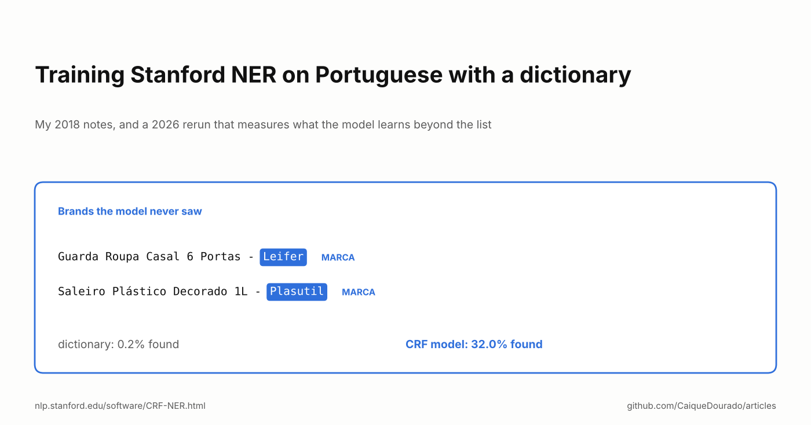
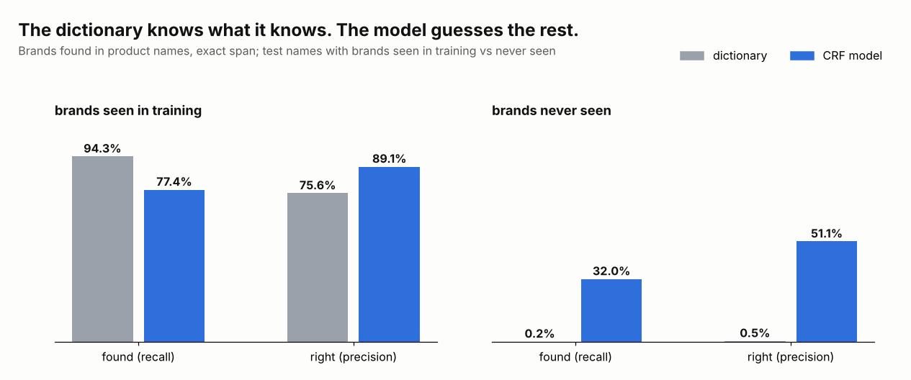

# Training Stanford NER on Portuguese with a dictionary

*My 2018 notes, and a 2026 rerun that measures what the model learns beyond the list.*

[Leia em português](README.pt-BR.md) · [On Medium](https://medium.com/@caiquedourado/training-stanford-ner-on-portuguese-with-a-dictionary-e3fcdee53bcd)



The search patterns of [part 1](../seven-ways-search-patterns/README.md) of the other series replace entities with
their type: *hotel barato em salvador* becomes `[turismo] barat [cidade]`. That needs a list of entities, and in 2018 I
had one, built from Wikipedia and other sources. Today it is the
[portuguese-entity-gazetteer](https://github.com/CaiqueDourado/portuguese-entity-gazetteer), with 307,397 entities.

A list only finds what is on it. So in March 2018 I tried the obvious next step: use the list to train a named-entity
recognizer, a model that would also find entities the list did not have. This article is what is left of that attempt,
and a rerun on public data that answers the question I never measured back then.

## What the 2018 folder shows

On 16 March 2018 I e-mailed myself a note titled "Steps (working) to train the ENTITIES model":

```text
cd stanford-ner-2018-02-27
java -cp stanford-ner.jar edu.stanford.nlp.ie.crf.CRFClassifier -prop portuguese.train.props
Article: https://nlp.stanford.edu/software/crf-faq.shtml#a
```

[Stanford NER](https://nlp.stanford.edu/software/CRF-NER.html) is a conditional random field (CRF): it labels each word
of a sentence using features of the word (its letters, its prefixes and suffixes, its shape: capitalised, digits…) and
of its neighbours. You train it with a file of one word per line, a tab, and the label, with a blank line between
sentences. The folder still has the files I touched that afternoon, and they tell a more honest story than the note:

- **The training file had four lines.** A pronoun and three first names. It was a test of the pipeline, not a model.
- **The note's properties file does not run.** It says `map = word = 0, answer = 1`, and Stanford NER parses the
  column number `" 0"` with its leading space: `NumberFormatException`. The batch file that actually ran used the
  FAQ's example properties (`map = word=0,answer=1`) with a few Portuguese lines pasted over the Jane Austen example.
- **The labels disagreed with each other.** That small file used `PERSON`, `PERS` and `PESSOA`. A CRF does not know
  they mean the same thing: they are three classes.
- **There is no model in the folder.** No `.ser.gz` was kept.

After that I trained it on the entity dictionary, but neither the model nor any number survived. What went into
production was the dictionary itself: every pattern in parts 1 to 3 was made by dictionary lookup, not by the model.

So the question stayed open: **what does a model trained from a dictionary learn that the dictionary does not
already know?**

## The rerun

I rebuilt the experiment in 2026 with the same jar (Stanford NER 3.9.1, the 2018-02-27 release) and the 2018
properties file, fixed only on the `map` line. The task is one I needed in the price-comparison catalog: find the
**brand** in a product name.

- **Data.** Product names from the public sample of
  [brazilian-ecommerce-products](https://github.com/CaiqueDourado/brazilian-ecommerce-products), where the store also
  filled a brand field. 4,353 distinct names in which that brand appears, 1,677 brands.
- **Labels from a dictionary.** Each name gets its own brand marked as `MARCA` wherever it appears. Nobody labelled
  anything by hand: this is exactly "train the model with the dictionary".
- **The split that matters.** 80% of the brands go to training. The test has two parts: names with brands the model
  saw in training (682 names), and names with brands it **never saw** (942 names).
- **The baseline.** The dictionary itself: the training brands, looked up in the test names, longest first.

Training takes 8 seconds of optimisation on a 2-core cloud VM with 2 GB for Java; the whole run, 18 seconds.
Everything is in [`experiment/`](experiment): `run.sh` rebuilds the files, trains, tests and scores.



On brands it has seen, the model is no better than the list: the dictionary finds 94.3% of them and the model 77.4%.
The model is more precise (89.1% against 75.6%), because the dictionary also marks brand words that appear in other
products' names.

On brands it has **never seen**, the dictionary finds 2 out of 961 (it can only find the training brands, so those
are accidents). The model finds **32.0%**, and half of what it marks is right (51.1%). That is what the dictionary
cannot do, and it is the only reason to train a model at all.

## What the model learned

Reading the hits, most of them look the same: *Guarda Roupa Casal 6 Portas 4 Gavetas - Leifer*, *Saleiro Plástico
Decorado 1L - Plasutil*. Brazilian stores often end the product name with a dash and the brand, and the CRF learned
that position, not the brands:

- brands after a final dash: 240 in the unseen test, **78%** found;
- brands anywhere else: 721, **17%** found.

A brand in the middle of the name (*Squeeze Térmico 700Ml Acte Sports - Preto*) looks like any other capitalised
word, and the model misses it.

The precision is also lower than it really is. Labels come from one brand field, so a name with a second brand, or
with the brand spelled another way, counts the model's answer as wrong: it marked *Wak Editora* in a book title and
*Conquista* in *Cabeceira Casal Roma Conquista Móveis*, both real brands, both "false positives". Counting any overlap
with the label as a hit, the model on unseen brands finds 52.9% and is right 84.2% of the time.

## Why the dictionary stayed

For deciding, the dictionary wins: it is right about everything it lists, it can be audited line by line, and fixing
it is editing a row. The model finds a third of the brands the list lacks, mostly because of one position cue, and gets
half of them wrong.

That makes the model useful for a different job: **growing the dictionary.** Run it over new names, collect what it
marks that the list does not have, and review that queue by hand. Each accepted suggestion becomes a dictionary entry,
and the next run starts from a bigger list.

## What I would tell myself in 2018

- **Measure the question you care about.** Testing on entities the model has seen only tests the dictionary again.
  Split by entity, not by sentence.
- **One name per label.** `PERSON`, `PERS` and `PESSOA` are three classes to the model.
- **Keep the model and the numbers.** A note that says "working" is not a result.
- **Use the model to suggest, the dictionary to decide.**

**Links**

- The experiment: [`experiment/`](experiment) (`prep.py`, `marca.props`, `run.sh`, `evaluate.py`, `results.json`)
- Stanford NER: [software page](https://nlp.stanford.edu/software/CRF-NER.html) and [FAQ](https://nlp.stanford.edu/software/crf-faq.shtml)
- The dictionary: [portuguese-entity-gazetteer](https://github.com/CaiqueDourado/portuguese-entity-gazetteer) ([Kaggle](https://www.kaggle.com/datasets/caiquedourado/portuguese-entity-gazetteer))
- The product names: [brazilian-ecommerce-products](https://github.com/CaiqueDourado/brazilian-ecommerce-products) ([Kaggle](https://www.kaggle.com/datasets/caiquedourado/catalogo-produtos-ecommerce-brasil))
- Previous article: [Enriching sign-up data with open APIs](../open-apis/README.md)
- More articles: [github.com/CaiqueDourado/articles](https://github.com/CaiqueDourado/articles)

*Caique Dourado has spent 20 years building crawlers, data pipelines and programmatic SEO in .NET and SQL Server.*
