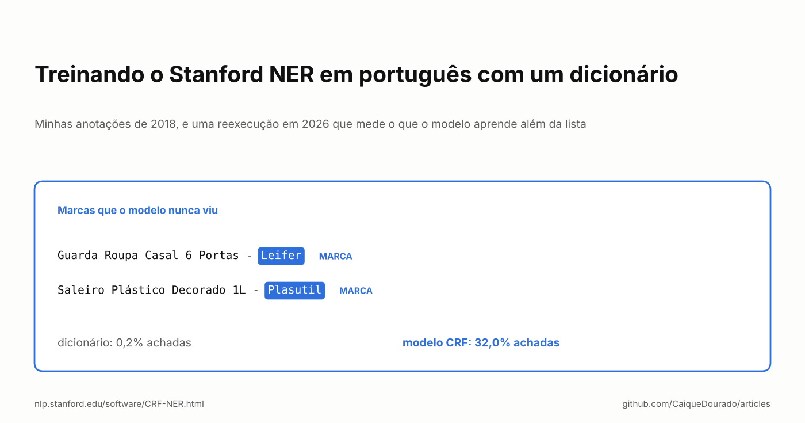
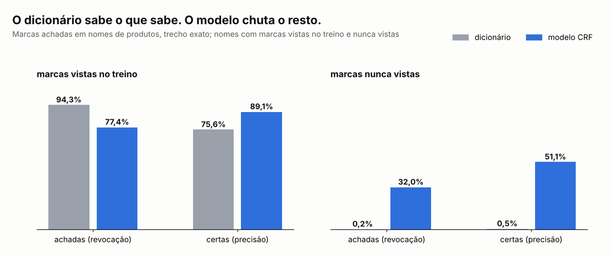

# Treinando o Stanford NER em português com um dicionário

*Minhas anotações de 2018, e uma reexecução em 2026 que mede o que o modelo aprende além da lista.*

[Read in English](README.md) · [Em inglês no Medium](https://medium.com/@caiquedourado/training-stanford-ner-on-portuguese-with-a-dictionary-e3fcdee53bcd)



Os padrões de busca da [parte 1](../seven-ways-search-patterns/README.pt-BR.md) da outra série trocam entidades pelo
tipo delas: *hotel barato em salvador* vira `[turismo] barat [cidade]`. Para isso é preciso uma lista de entidades, e em
2018 eu tinha uma, montada a partir da Wikipédia e de outras fontes. Hoje ela é o
[portuguese-entity-gazetteer](https://github.com/CaiqueDourado/portuguese-entity-gazetteer), com 307.397 entidades.

Uma lista só acha o que está nela. Então, em março de 2018, tentei o passo seguinte óbvio: usar a lista para treinar um
reconhecedor de entidades nomeadas, um modelo que achasse também as entidades que a lista não tinha. Este artigo é o
que sobrou dessa tentativa, e uma reexecução com dados públicos que responde a pergunta que eu nunca medi na época.

## O que a pasta de 2018 mostra

Em 16 de março de 2018 mandei um e-mail para mim mesmo chamado "Passos (funcionando) para treinar o modelo de
ENTIDADES":

```text
cd stanford-ner-2018-02-27
java -cp stanford-ner.jar edu.stanford.nlp.ie.crf.CRFClassifier -prop portuguese.train.props
Artigo: https://nlp.stanford.edu/software/crf-faq.shtml#a
```

O [Stanford NER](https://nlp.stanford.edu/software/CRF-NER.html) é um CRF (*conditional random field*): ele rotula cada
palavra da frase usando características da palavra (as letras, os prefixos e sufixos, o formato: maiúscula, dígitos…)
e das vizinhas. O treino é um arquivo com uma palavra por linha, um tab e o rótulo, e uma linha em branco entre as
frases. A pasta ainda tem os arquivos que mexi naquela tarde, e eles contam uma história mais honesta do que a
anotação:

- **O arquivo de treino tinha quatro linhas.** Um pronome e três primeiros nomes. Era um teste do caminho, não um
  modelo.
- **O arquivo de propriedades da anotação não roda.** Ele diz `map = word = 0, answer = 1`, e o Stanford NER lê o
  número da coluna como `" 0"`, com o espaço na frente: `NumberFormatException`. O `.bat` que de fato rodou usava as
  propriedades do exemplo do FAQ (`map = word=0,answer=1`), com algumas linhas em português coladas por cima do exemplo
  de Jane Austen.
- **Os rótulos discordavam entre si.** Aquele arquivo pequeno usava `PERSON`, `PERS` e `PESSOA`. Um CRF não sabe que
  são a mesma coisa: para ele, são três classes.
- **Não há modelo na pasta.** Nenhum `.ser.gz` foi guardado.

Depois disso treinei com o dicionário de entidades, mas nem o modelo nem nenhum número sobreviveram. O que foi para
produção foi o próprio dicionário: todos os padrões das partes 1 a 3 foram feitos por consulta ao dicionário, não pelo
modelo.

A pergunta ficou em aberto: **o que um modelo treinado com um dicionário aprende que o dicionário ainda não sabe?**

## A reexecução

Refiz o experimento em 2026 com o mesmo jar (Stanford NER 3.9.1, a versão de 2018-02-27) e o arquivo de propriedades de
2018, corrigido só na linha `map`. A tarefa é uma que eu precisava no catálogo de comparação de preços: achar a
**marca** no nome do produto.

- **Dados.** Nomes de produtos da amostra pública do
  [brazilian-ecommerce-products](https://github.com/CaiqueDourado/brazilian-ecommerce-products), em que a loja também
  preencheu o campo de marca. 4.353 nomes distintos em que essa marca aparece, 1.677 marcas.
- **Rótulos vindos de um dicionário.** Cada nome tem a própria marca marcada como `MARCA` onde ela aparece. Ninguém
  rotulou nada à mão: é exatamente "treinar o modelo com o dicionário".
- **A divisão que importa.** 80% das marcas vão para o treino. O teste tem duas partes: nomes com marcas que o modelo
  viu no treino (682 nomes) e nomes com marcas que ele **nunca viu** (942 nomes).
- **A base de comparação.** O próprio dicionário: as marcas do treino, procuradas nos nomes do teste, da mais longa
  para a mais curta.

O treino leva 8 segundos de otimização numa VM de nuvem com 2 núcleos e 2 GB para o Java; a execução inteira, 18
segundos. Tudo está em [`experiment/`](experiment): o `run.sh` monta os arquivos, treina, testa e calcula as notas.



Nas marcas que já viu, o modelo não é melhor do que a lista: o dicionário acha 94,3% delas e o modelo, 77,4%. O modelo
é mais preciso (89,1% contra 75,6%), porque o dicionário também marca palavras de marca que aparecem no nome de outros
produtos.

Nas marcas que **nunca viu**, o dicionário acha 2 de 961 (ele só sabe achar as marcas do treino, então essas são
acidentes). O modelo acha **32,0%**, e metade do que ele marca está certo (51,1%). É isso que o dicionário não consegue
fazer, e é o único motivo para treinar um modelo.

## O que o modelo aprendeu

Lendo os acertos, a maioria tem a mesma cara: *Guarda Roupa Casal 6 Portas 4 Gavetas - Leifer*, *Saleiro Plástico
Decorado 1L - Plasutil*. As lojas brasileiras costumam terminar o nome do produto com um traço e a marca, e o CRF
aprendeu essa posição, não as marcas:

- marcas depois de um traço no fim: 240 no teste de marcas novas, **78%** achadas;
- marcas em qualquer outro lugar: 721, **17%** achadas.

Uma marca no meio do nome (*Squeeze Térmico 700Ml Acte Sports - Preto*) parece qualquer outra palavra com maiúscula, e
o modelo não acha.

A precisão também é menor no papel do que de verdade. Os rótulos vêm de um único campo de marca, então um nome com uma
segunda marca, ou com a marca escrita de outro jeito, conta a resposta do modelo como errada: ele marcou *Wak Editora*
no título de um livro e *Conquista* em *Cabeceira Casal Roma Conquista Móveis*, as duas marcas de verdade, as duas
"falsos positivos". Contando como acerto qualquer sobreposição com o rótulo, o modelo nas marcas novas acha 52,9% e
acerta 84,2% das vezes.

## Por que o dicionário ficou

Para decidir, o dicionário ganha: ele acerta tudo o que lista, dá para auditar linha por linha, e corrigir é editar
uma linha. O modelo acha um terço das marcas que faltam na lista, principalmente por causa de uma pista de posição, e
erra metade delas.

Isso deixa o modelo útil para outro trabalho: **fazer o dicionário crescer.** Rode o modelo em nomes novos, junte o que
ele marca e a lista não tem, e revise essa fila à mão. Cada sugestão aceita vira uma linha do dicionário, e a próxima
rodada começa de uma lista maior.

## O que eu diria para mim mesmo em 2018

- **Meça a pergunta que importa.** Testar com entidades que o modelo já viu só testa o dicionário de novo. Divida por
  entidade, não por frase.
- **Um nome por rótulo.** `PERSON`, `PERS` e `PESSOA` são três classes para o modelo.
- **Guarde o modelo e os números.** Uma anotação que diz "funcionando" não é um resultado.
- **Use o modelo para sugerir e o dicionário para decidir.**

**Links**

- O experimento: [`experiment/`](experiment) (`prep.py`, `marca.props`, `run.sh`, `evaluate.py`, `results.json`)
- Stanford NER: [página do software](https://nlp.stanford.edu/software/CRF-NER.html) e [FAQ](https://nlp.stanford.edu/software/crf-faq.shtml)
- O dicionário: [portuguese-entity-gazetteer](https://github.com/CaiqueDourado/portuguese-entity-gazetteer) ([Kaggle](https://www.kaggle.com/datasets/caiquedourado/portuguese-entity-gazetteer))
- Os nomes de produtos: [brazilian-ecommerce-products](https://github.com/CaiqueDourado/brazilian-ecommerce-products) ([Kaggle](https://www.kaggle.com/datasets/caiquedourado/catalogo-produtos-ecommerce-brasil))
- Artigo anterior: [Enriquecendo cadastros com APIs abertas](../open-apis/README.pt-BR.md)
- Mais artigos: [github.com/CaiqueDourado/articles](https://github.com/CaiqueDourado/articles)

*Caique Dourado constrói há 20 anos crawlers, pipelines de dados e SEO programático em .NET e SQL Server.*
