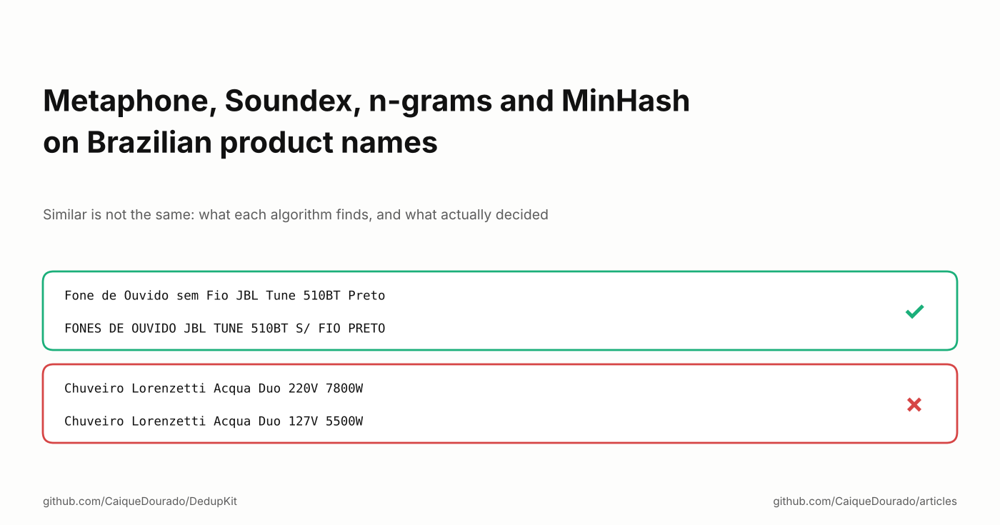
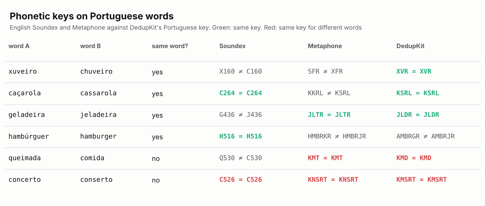
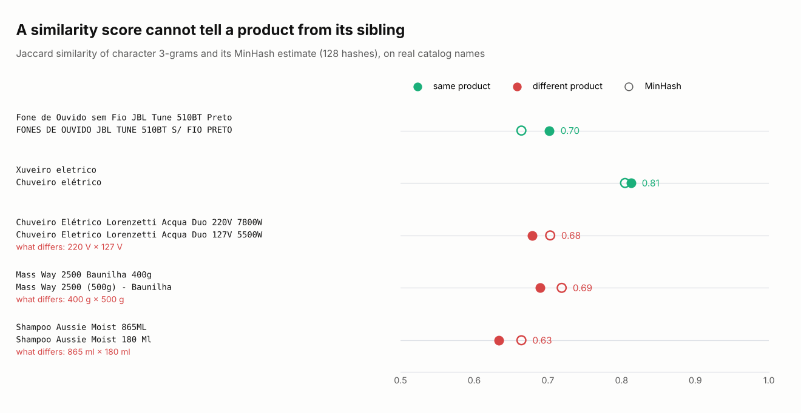
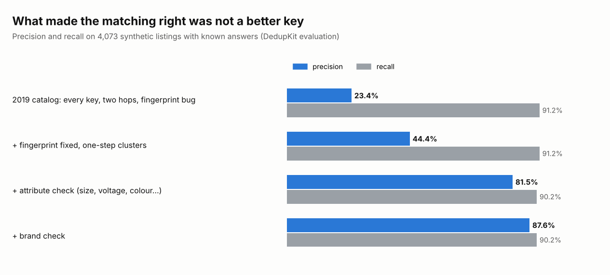

# Metaphone, Soundex, n-grams and MinHash on Brazilian product names

*Similar is not the same: what each algorithm finds, and what actually decided.*

[Leia em português](README.pt-BR.md)

Between 2019 and 2024 I ran a price-comparison catalog that collected 114.6 million offers from Brazilian online
stores. Every store writes the same product its own way: *Fone de Ouvido sem Fio JBL Tune 510BT Preto* in one,
*FONES DE OUVIDO JBL TUNE 510BT S/ FIO PRETO* in the next. To show one page per product, the offers had to be grouped.

The textbook answer is a similarity algorithm. I tried most of them: Soundex, Metaphone, character n-grams,
fingerprints, set similarity. This article is what each one found on real Portuguese product names, and the
uncomfortable conclusion: none of them decided which offers were the same product. The code that came out of it is
open, in Python and .NET, as [DedupKit](https://github.com/CaiqueDourado/DedupKit).

## Four families of "similar"

The algorithms people reach for fall into four families, and each one answers a different question:

- **Phonetic keys** (Soundex, Metaphone): *do these words sound alike?* They turn a word into a code of its
  sounds, so *xuveiro* and *chuveiro* can meet.
- **Character n-grams**: *do these strings share pieces?* OpenRefine's n-gram fingerprint cuts a name into pairs of
  letters, keeps each pair once and sorts them, so word order and repeated letters stop mattering.
- **Token keys** (fingerprints): *do these names have the same words?* Lower case, no accents, no punctuation, unique
  words, sorted.
- **Set similarity** (Jaccard, and MinHash to estimate it at scale): *how much of the two strings overlaps?* A
  number between 0 and 1 instead of a yes or no.

The first three make **keys**: two names with the same key land in the same block. The fourth makes a **score**.
Both are useful. Neither, as we will see, knows what a product is.

## Phonetic keys were written for English

Soundex was patented in 1918 to file English surnames, and Metaphone (1990) also encodes English spelling. Most
databases ship one of them (SQL Server has `SOUNDEX()`), so it is tempting to point them at Portuguese:

English Soundex misses *xuveiro*/*chuveiro*, because it keeps the first letter as is. English Metaphone misses
*caçarola*/*cassarola*. DedupKit's own Portuguese key, written from the rules of Portuguese spelling (`ch` sounds like `x`; `ç`, `ss` and `c` before `e` or `i` sound like
`s`), gets three of the four spelling pairs right. It misses *hambúrguer*/*hamburger*, where the `g` before `e`
really is pronounced differently.

The two red rows matter more. *Queimada* (burnt) and *comida* (food) get the same key from Metaphone and from my key.
*Concerto* (concert) and *conserto* (repair) are the same sound and different words. A phonetic key is right to join
them, because that is its job, and that is exactly why it cannot be the one deciding.

## A name through each key

Back to the headphones. These are the two real names and what each key makes of them:

| Key | Listing A | Listing B | Same? |
|---|---|---|:---:|
| normalized text | fone de ouvido sem fio jbl tune 510bt preto | fones de ouvido jbl tune 510bt s fio preto | no |
| fingerprint (unique words, sorted) | 510bt de fio fone jbl ouvido preto sem tune | 510bt de fio fones jbl ouvido preto s tune | no |
| phonetic, word by word | FN D OVD SM F JB TN 510BT PRT | FNS D OVD JB TN 510BT S F PRT | no |
| letter pairs | 0b 10 51 bl bt de … | 0b 10 51 bl bt de … | no |
| words, singular, no stopwords, sorted | 510bt fio fone jbl ouvido preto tune | 510bt fio fone jbl ouvido preto tune | **yes** |

Only the last one joins them: it drops *de*, *sem* and *s/*, turns *fones* into *fone* and sorts what is left. In
2019, before writing the matching routine, I computed about 15 keys for every distinct product name of the catalog
(five Soundex variants, three Metaphone variants, OpenRefine's fingerprint and n-gram, three token fingerprints and
the omission and skeleton keys used in spelling correction) and compared them pair by pair. The keys that survived
are the ones DedupKit ships. Measured again on 715 hand-checked pairs:

| Key | Same-product pairs joined | Different-product pairs joined | Precision |
|---|---:|---:|---:|
| normalized text | 11 | 0 | 100% |
| fingerprint | 16 | 1 | 94% |
| words, singular, no stopwords | 16 | 1 | 94% |
| Portuguese phonetic key | 12 | 2 | 86% |
| n-gram fingerprint | 13 | 0 | 100% |
| phonetic key without numbers | 22 | 219 | 9% |
| skeleton key (spelling correction) | 36 | 254 | 12% |
| omission key (spelling correction) | 45 | 268 | 14% |

The losers fail the same way: they throw away something that identifies the product. The phonetic key without numbers
joins *Shampoo Aussie Moist 865ML* with *180 Ml*. The omission key keeps each consonant once, in a fixed order, and put
*Acabamento para Registro Gaveta… Deca* (a tap finish) and *Bandagem Vollke Elástica Preta 5 Metros* (a bandage) in
the same block.

## MinHash: a better number is still a number

MinHash is the standard tool for near-duplicates at scale: it estimates the Jaccard similarity of two sets (here,
the 3-letter pieces of each name) from a short signature, so you never compare every pair. It works. The trouble is
what the number means:

The JBL headphones score 0.70. The same Lorenzetti shower in 220 V and 127 V scores 0.68. The same supplement in 400 g
and 500 g scores 0.69. There is no threshold that keeps the first pair and drops the other two, because to the
algorithm they are the same kind of thing: two long strings that differ in a few characters. To a customer, a 127 V
shower plugged into 220 V burns out on the first bath.

## What actually decided

Keys and scores find **candidates**. What decided was a set of plain rules applied to each candidate pair:

1. **A shared barcode is not enough.** Stores reuse one barcode for a whole product line, so a barcode match also
   needs the names to share a word.
2. **Different measures, different products.** Extract weight, volume, voltage, power, memory, size, colour and pack
   quantity from each name, and refuse the pair when they conflict, knowing that 110 V and 127 V are the same network
   and that inox, prata and cromado are one colour.
3. **Write down why.** Every link keeps the rule and value that made it, and every refused pair keeps the reason.

On 4,073 synthetic listings with known answers, the difference looks like this:

The 2019 catalog grouped with 23.4% precision: three out of four merges were wrong. Fixing the keys took it to 44%.
The attribute check, which is not a similarity algorithm at all, took it to 81.5% while recall barely moved. The brand
check adds six points on clean data, but it is off by default: on real marketplace data, where the brand field holds
the seller's name, it refused thousands of correct pairs. On the real catalog sample, the same attribute check would
split 795 of 4,030 groups that the old catalog kept on one page.

## The bugs that the numbers found

Rewriting the routine with tests found three bugs that had been running in production:

- **The fingerprint kept every other word.** The keyer I used built its key from alternating words, so different
  products could share it. It had also been used to group review sentences, where it joined *ótima qualidade* (great
  quality) with *péssima qualidade* (terrible quality).
- **The skeleton key repeated itself.** Its vowel part repeated the consonants: *DVD Canta Rio 98* and *Dvd -
  Centurião* both became `D/VCNTR/VCNTR`.
- **The result depended on arrival order.** The two-hop grouping linked A to B to C differently depending on which
  offer came first. DedupKit uses connected components, which do not care.

## What I would tell myself in 2019

- **Use similarity to find candidates, never to decide.** Keys and MinHash are for blocking: cheap ways to avoid
  comparing every pair. The decision needs rules about the domain.
- **Keep the numbers in the key.** In product names, digits are the product: 400 g, 220 V, 510BT.
- **Portuguese needs Portuguese rules.** Plurals (*fogões* → *fogao*), stopwords (*de*, *sem*, *s/*) and phonetics
  (*ch* = *x*) change the result more than the choice of algorithm.
- **Measure on hard pairs.** Every algorithm looks good on easy duplicates. The 715 pairs above were chosen hard: same
  barcode or photo, different wording.

**Links**

- The library: [DedupKit](https://github.com/CaiqueDourado/DedupKit) (Python and .NET, same results in both)
- The pairs used to measure it: [product-matching-pairs-portuguese](https://github.com/CaiqueDourado/product-matching-pairs-portuguese)
- The catalog: [brazilian-ecommerce-products](https://github.com/CaiqueDourado/brazilian-ecommerce-products) ([Kaggle](https://www.kaggle.com/datasets/caiquedourado/catalogo-produtos-ecommerce-brasil))
- More articles: [github.com/CaiqueDourado/articles](https://github.com/CaiqueDourado/articles)

*Caique Dourado has spent 20 years building crawlers, data pipelines and programmatic SEO in .NET and SQL Server.*
