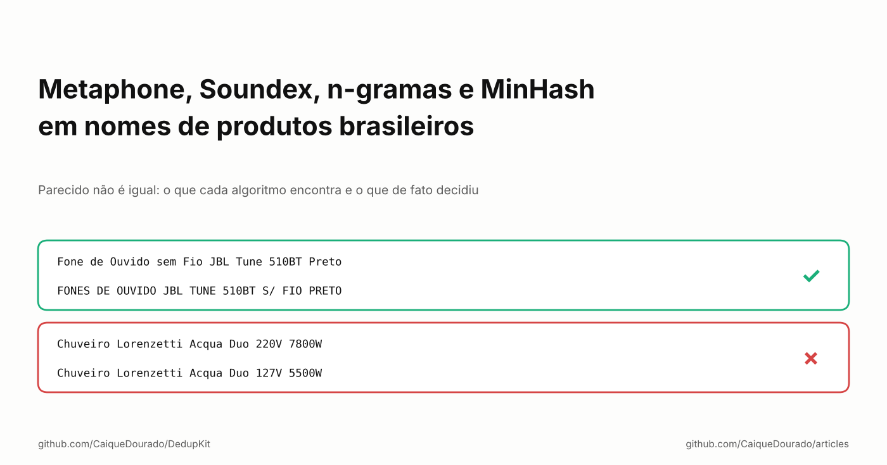
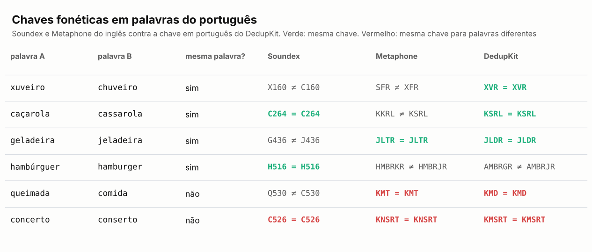
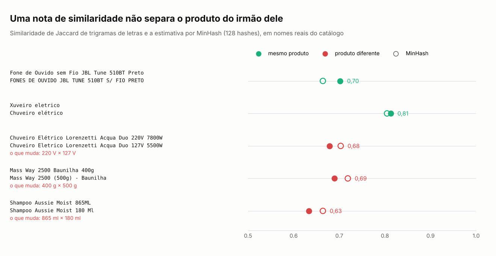
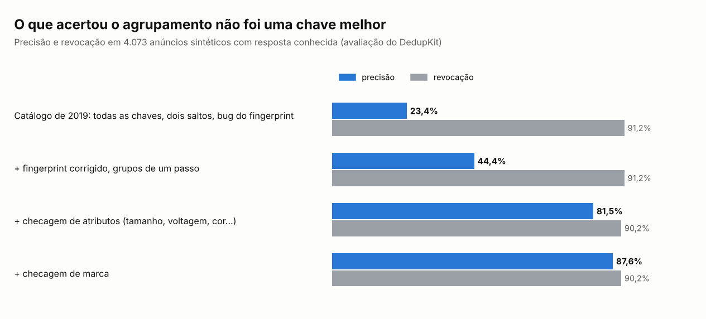

# Metaphone, Soundex, n-gramas e MinHash em nomes de produtos brasileiros

*Parecido não é igual: o que cada algoritmo encontra e o que de fato decidiu.*

[Read in English](README.md)

Entre 2019 e 2024 eu mantive um catálogo de comparação de preços que coletou 114,6 milhões de ofertas de lojas online
brasileiras. Cada loja escreve o mesmo produto do seu jeito: *Fone de Ouvido sem Fio JBL Tune 510BT Preto* numa,
*FONES DE OUVIDO JBL TUNE 510BT S/ FIO PRETO* na outra. Para mostrar uma página por produto, as ofertas precisavam
ser agrupadas.

A resposta de livro é um algoritmo de similaridade. Testei quase todos: Soundex, Metaphone, n-gramas de letras,
fingerprints, similaridade de conjuntos. Este artigo é o que cada um encontrou em nomes reais de produtos em
português, e a conclusão incômoda: nenhum deles decidiu quais ofertas eram o mesmo produto. O código que saiu disso
está aberto, em Python e .NET, como [DedupKit](https://github.com/CaiqueDourado/DedupKit).

## Quatro famílias de "parecido"

Os algoritmos que a gente costuma usar caem em quatro famílias, e cada uma responde uma pergunta diferente:

- **Chaves fonéticas** (Soundex, Metaphone): *essas palavras soam parecido?* Elas transformam a palavra num código dos
  sons, para *xuveiro* e *chuveiro* se encontrarem.
- **N-gramas de letras**: *essas palavras têm pedaços em comum?* O fingerprint de n-gramas do OpenRefine corta o nome
  em pares de letras, guarda cada par uma vez e ordena, então a ordem das palavras e as letras repetidas deixam de
  importar.
- **Chaves de palavras** (fingerprints): *esses nomes têm as mesmas palavras?* Minúsculas, sem acento, sem pontuação,
  palavras únicas, em ordem alfabética.
- **Similaridade de conjuntos** (Jaccard, e MinHash para estimá-la em escala): *quanto dos dois textos se sobrepõe?*
  Um número entre 0 e 1, em vez de sim ou não.

As três primeiras geram **chaves**: dois nomes com a mesma chave caem no mesmo bloco. A quarta gera uma **nota**. As
duas servem. Nenhuma, como vamos ver, sabe o que é um produto.

## Chaves fonéticas foram feitas para o inglês

O Soundex foi patenteado em 1918 para arquivar sobrenomes em inglês, e o Metaphone (1990) também codifica a grafia do
inglês. Quase todo banco de dados traz um deles (o SQL Server tem `SOUNDEX()`), e dá vontade de usar em português:

O Soundex do inglês erra *xuveiro*/*chuveiro*, porque mantém a primeira letra como está. O Metaphone do inglês erra
*caçarola*/*cassarola*. A chave do DedupKit, escrita com as regras da grafia do português (`ch` soa como `x`; `ç`, `ss`
e `c` antes de `e` ou `i` soam como `s`), acerta três dos quatro pares de grafia. Erra *hambúrguer*/*hamburger*, em
que o `g` antes de `e` tem mesmo outro som.

As duas linhas vermelhas importam mais. *Queimada* e *comida* recebem a mesma chave no Metaphone e na minha.
*Concerto* e *conserto* têm o mesmo som e são palavras diferentes. A chave fonética está certa em juntá-las, porque
esse é o trabalho dela, e é exatamente por isso que ela não pode ser quem decide.

## Um nome em cada chave

Voltando aos fones. Estes são os dois nomes reais e o que cada chave faz com eles:

| Chave | Anúncio A | Anúncio B | Igual? |
|---|---|---|:---:|
| texto normalizado | fone de ouvido sem fio jbl tune 510bt preto | fones de ouvido jbl tune 510bt s fio preto | não |
| fingerprint (palavras únicas, em ordem) | 510bt de fio fone jbl ouvido preto sem tune | 510bt de fio fones jbl ouvido preto s tune | não |
| fonética, palavra por palavra | FN D OVD SM F JB TN 510BT PRT | FNS D OVD JB TN 510BT S F PRT | não |
| pares de letras | 0b 10 51 bl bt de … | 0b 10 51 bl bt de … | não |
| palavras no singular, sem stopwords, em ordem | 510bt fio fone jbl ouvido preto tune | 510bt fio fone jbl ouvido preto tune | **sim** |

Só a última junta os dois: ela tira *de*, *sem* e *s/*, transforma *fones* em *fone* e ordena o que sobra. Em 2019,
antes de escrever a rotina de agrupamento, calculei cerca de 15 chaves para cada nome distinto do catálogo (cinco
variações de Soundex, três de Metaphone, o fingerprint e o n-grama do OpenRefine, três fingerprints de palavras e as
chaves de omissão e de esqueleto usadas em correção ortográfica) e comparei par a par. As chaves que sobreviveram são
as que o DedupKit traz. Medidas de novo em 715 pares conferidos à mão:

| Chave | Pares do mesmo produto juntados | Pares de produtos diferentes juntados | Precisão |
|---|---:|---:|---:|
| texto normalizado | 11 | 0 | 100% |
| fingerprint | 16 | 1 | 94% |
| palavras no singular, sem stopwords | 16 | 1 | 94% |
| chave fonética do português | 12 | 2 | 86% |
| fingerprint de n-gramas | 13 | 0 | 100% |
| chave fonética sem números | 22 | 219 | 9% |
| chave de esqueleto (correção ortográfica) | 36 | 254 | 12% |
| chave de omissão (correção ortográfica) | 45 | 268 | 14% |

As perdedoras erram do mesmo jeito: jogam fora algo que identifica o produto. A chave fonética sem números junta
*Shampoo Aussie Moist 865ML* com *180 Ml*. A chave de omissão guarda cada letra uma vez, numa ordem fixa, e colocou
*Acabamento para Registro Gaveta… Deca* e *Bandagem Vollke Elástica Preta 5 Metros* no mesmo bloco.

## MinHash: um número melhor ainda é um número

O MinHash é a ferramenta padrão para quase-duplicados em escala: estima a similaridade de Jaccard de dois conjuntos
(aqui, os pedaços de 3 letras de cada nome) a partir de uma assinatura curta, sem comparar todos os pares. Funciona.
O problema é o que o número significa:

Os fones JBL têm nota 0,70. O mesmo chuveiro Lorenzetti em 220 V e 127 V tem 0,68. O mesmo suplemento em 400 g e
500 g tem 0,69. Não existe um corte que mantenha o primeiro par e descarte os outros dois, porque para o algoritmo
eles são a mesma coisa: dois textos longos que diferem em poucos caracteres. Para o cliente, um chuveiro de 127 V
ligado em 220 V queima no primeiro banho.

## O que de fato decidiu

Chaves e notas encontram **candidatos**. Quem decidiu foi um conjunto de regras simples aplicado a cada par candidato:

1. **Código de barras igual não basta.** Lojas usam um código para a linha inteira de produtos, então um par pelo
   código também precisa ter uma palavra em comum no nome.
2. **Medidas diferentes, produtos diferentes.** Extrair peso, volume, voltagem, potência, memória, tamanho, cor e
   quantidade da embalagem de cada nome e recusar o par quando batem de frente, sabendo que 110 V e 127 V são a mesma
   rede e que inox, prata e cromado são uma cor só.
3. **Anotar o porquê.** Cada ligação guarda a regra e o valor que a fizeram, e cada par recusado guarda o motivo.

Em 4.073 anúncios sintéticos com resposta conhecida, a diferença é esta:

O catálogo de 2019 agrupava com 23,4% de precisão: três de cada quatro junções estavam erradas. Corrigir as chaves
levou a 44%. A checagem de atributos, que nem é um algoritmo de similaridade, levou a 81,5%, quase sem mexer na
revocação. A checagem de marca soma seis pontos em dados limpos, mas fica desligada por padrão: em dados reais de
marketplace, em que o campo de marca traz o nome do vendedor, ela recusou milhares de pares corretos. Na amostra real
do catálogo, a mesma checagem de atributos separaria 795 dos 4.030 grupos que o catálogo antigo mostrava numa página
só.

## Os bugs que os números acharam

Reescrever a rotina com testes achou três bugs que rodavam em produção:

- **O fingerprint guardava uma palavra sim, outra não.** O gerador de chave que eu usava montava a chave com palavras
  alternadas, então produtos diferentes podiam ter a mesma. Ele também agrupou frases de avaliações, e juntou *ótima
  qualidade* com *péssima qualidade*.
- **A chave de esqueleto se repetia.** A parte das vogais repetia as consoantes: *DVD Canta Rio 98* e *Dvd -
  Centurião* viravam `D/VCNTR/VCNTR`.
- **O resultado dependia da ordem de chegada.** O agrupamento em dois saltos ligava A a B a C de um jeito ou de outro
  conforme a oferta que chegava primeiro. O DedupKit usa componentes conexos, que não ligam para a ordem.

## O que eu diria para mim mesmo em 2019

- **Use similaridade para achar candidatos, nunca para decidir.** Chaves e MinHash servem para blocar: jeitos baratos
  de não comparar todos os pares. A decisão precisa de regras do domínio.
- **Deixe os números na chave.** Em nome de produto, o número é o produto: 400 g, 220 V, 510BT.
- **Português pede regras de português.** Plural (*fogões* → *fogao*), stopwords (*de*, *sem*, *s/*) e fonética
  (*ch* = *x*) mudam mais o resultado do que a escolha do algoritmo.
- **Meça em pares difíceis.** Todo algoritmo vai bem em duplicado fácil. Os 715 pares acima foram escolhidos difíceis:
  mesmo código de barras ou foto, nome escrito de outro jeito.

**Links**

- A biblioteca: [DedupKit](https://github.com/CaiqueDourado/DedupKit) (Python e .NET, mesmo resultado nos dois)
- Os pares usados para medir: [product-matching-pairs-portuguese](https://github.com/CaiqueDourado/product-matching-pairs-portuguese)
- O catálogo: [brazilian-ecommerce-products](https://github.com/CaiqueDourado/brazilian-ecommerce-products) ([Kaggle](https://www.kaggle.com/datasets/caiquedourado/catalogo-produtos-ecommerce-brasil))
- Mais artigos: [github.com/CaiqueDourado/articles](https://github.com/CaiqueDourado/articles)

*Caique Dourado constrói há 20 anos crawlers, pipelines de dados e SEO programático em .NET e SQL Server.*
